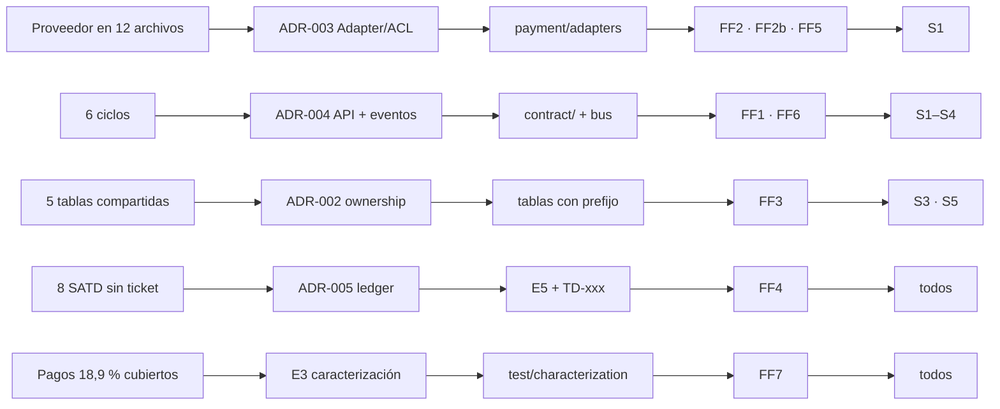
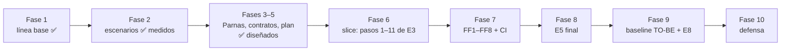

# Guía de diseño: qué hay que hacer y cómo se cumple el caso

> Índice de todo el diseño del Caso DecidArch / FlowNow. Cada afirmación remite a su documento. Las cifras AS-IS salen de `scripts/baseline.sh`; las del TO-BE son **metas** hasta medirlas.

## 1. Mapa de entregables (§17) y de la rúbrica (§18)

| ID | Entregable | Documento | Peso rúbrica | Estado |
|---|---|---|---|---|
| E1 | Diagnóstico AS-IS | [E1](E1-diagnostico-as-is.md) · [baseline](baseline/as-is/resumen.md) | Diagnóstico 10 % | **Medido** (C4 AS-IS, 5 escenarios, ciclos, ownership) |
| E2 | Arquitectura TO-BE (Parnas) | [E2](E2-arquitectura-to-be.md) · [fichas](modules/) | Parnas 20 % · Cohesión/acoplamiento 15 % · Ownership/interoperabilidad 15 % | **Diseñado** (C4 L1–L3, dinámico, despliegue) |
| E3 | Plan e implementación | [E3](E3-plan-refactoring.md) | Refactoring y pruebas 15 % | Plan **diseñado**; implementación pendiente |
| E4 | Fitness functions + quality gate + CI/CD | [E4](E4-fitness-functions.md) · [ci/](../ci/README.md) | FF 10 % | 8 reglas **diseñadas** (FF1 y FF4 con base ejecutable) |
| E5 | Gestión de SATD | [E5](E5-debt-ledger.md) | SATD 10 % | Inventario real + 10 entradas propuestas |
| E6 | ADRs | [adr/](adr/) (006 redactados) | ADRs/Vibe Arch. 5 % | **Aceptados** (2026-11-04) con verificación medida; ADR-002/003/006 con alcance parcial declarado |
| E7 | Architectural Intent | [E7](E7-architectural-intent.md) · [intents/](intents/) | ídem | Plantilla + 2 intents |
| E8 | Informe AS-IS/TO-BE | [E8](E8-evidencia-as-is-to-be.md) | transversal (§19) | AS-IS medido; TO-BE por medir |

## 2. Cumplimiento de las condiciones obligatorias (§16.2)

| # | Condición | Dónde se cumple |
|---|---|---|
| 1 | Aplicar el criterio de Parnas | E2 §9 (secreto por módulo), fichas `modules/` |
| 2 | Separar responsabilidades, justificar cohesión y acoplamiento | E2 §5, §5.1 (grafo acíclico), §14 (granularidad) |
| 3 | Declarar ownership de datos | E2 §10, ADR-002, FF3 |
| 4 | Contratos de interoperabilidad | E2 §11 (API, eventos, DTO, schemas, versionado), ADR-004 |
| 5 | Gestionar SATD sin ocultarla | E5, ADR-005, FF4 |
| 6 | Refactoring incremental con pruebas | E3 §2–§4 (caracterización primero, 12 pasos) |
| 7 | ≥3 decisiones convertidas en reglas | E4 §2 (8 reglas) |
| 8 | Documentar con ADR | `adr/` (6) |
| 9 | Instrucciones de Vibe Architecting | E7, `intents/`, E4 §6–7 |
| 10 | Evidencia AS-IS / TO-BE | E8 (matriz, escenarios, trazabilidad §19) |

## 3. Quality gate del ejercicio (Anexo E)

| Regla | Umbral | AS-IS medido | Cómo se alcanza |
|---|---|---|---|
| SATD no gestionada | 0 | 8 | E5 + FF4 |
| Ciclos | 0 | 6 | pasos 6, 8, 10, 11 de E3 + FF1 |
| Dependencias prohibidas | 0 | sin regla | FF2 + FF6 |
| Hard-coded secretos/URLs | 0 | 9 + 7 líneas | paso 2 + FF5 |
| Fitness functions | ≥ 3 | 0 | 8 diseñadas |
| ADRs | ≥ 5 | 0 | 6 |
| Escenarios | ≥ 4 | 5 medidos | E1 §7, E8 |
| Pruebas críticas | verdes antes y después | 5 verdes (sin pagos) | paso 1 de E3 |

## 4. Cadena de trazabilidad (problema → decisión → artefacto → regla → escenario)



## 5. Ruta de trabajo (resumen; detalle en `PLAN.md` y E3)



Lo que ya está hecho es **diseño y diagnóstico**. Lo que sigue (Fases 6–9) es implementación y medición; hasta entonces, ninguna meta del TO-BE es evidencia.

## 6. Borrador de respuestas para la defensa (§20)

1. **Secreto principal por módulo:** Payment = proveedor/reintentos/FX/estados; Customer = modelo y política de tiers; Request = estados, precio y prioridad; Notification = canales y proveedores; Reporting = almacén de lectura; Integration = protocolos de CRM/ERP; Identity = credenciales y token.
2. **Módulo a eliminar al simplificar:** Integration (se fusionaría con `platform`/outbox); Notification sigue siendo la primera línea de S2.
3. **Dependencia aún riesgosa:** `Customer ⇢ Payment` por eventos (totalSpent/tier); se mitiga con contrato `v1` y sentido único.
4. **Deuda aceptada:** TD-003 (bono gold), TD-004 (cola ERP), TD-009 (eventos en proceso), TD-010 (campos legacy `stripey_*`), cada una con owner, fecha y verificación.
5. **Interfaz sin beneficio:** `authorizePayment/capturePayment` (el proveedor cobra en un paso), `GatewayFactory`, `IPaymentGateway`/`INotifier` genéricos.
6. **Patrón rechazado:** Factory abstracta de proveedores, CQRS/Event Sourcing, saga distribuida (E2 §15).
7. **Cómo sabemos que se preservó el comportamiento:** suite de caracterización black-box idéntica y verde antes y después (E3 §3, §7).
8. **FF que protege la decisión más importante:** FF2/FF2b para ocultar el proveedor; FF1 para el grafo; FF3 para ownership.
9. **Si cambia el modelo de Customer:** se modifica Customer y, a lo sumo, el DTO `v1`→`v2`; S3 pasa de 13 archivos/7 áreas a 1 módulo (meta; se mide).
10. **Cómo evitar que un agente reintroduzca el problema:** intent versionado + hooks locales + CI bloqueante + CODEOWNERS + `prove-rules-fail` (E4 §6–7).

## 7. Cómo regenerar la evidencia

```bash
scripts/baseline.sh flownow docs/baseline/as-is    # AS-IS (hecho)
scripts/baseline.sh flownow docs/baseline/to-be    # TO-BE (tras implementar)
npx --yes @mermaid-js/mermaid-cli@11 -i docs/E2-arquitectura-to-be.md -o /tmp/E2.md   # validar diagramas
```
