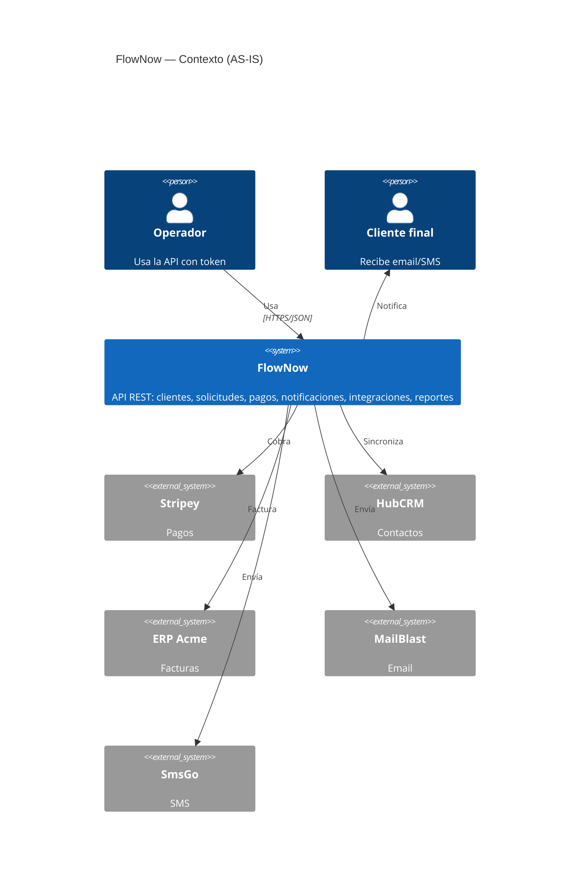
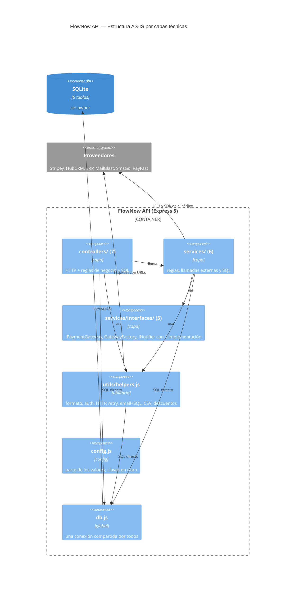
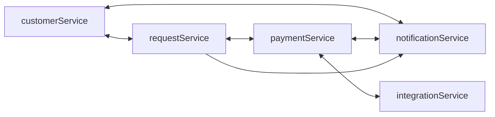

# E1. Diagnóstico AS-IS

> §17.1 · Máximo sugerido: 5 páginas más anexos automáticos.
> Toda cifra proviene de `scripts/baseline.sh` → `docs/baseline/as-is/` (resumen en `resumen.md`). No se copian números a mano.

**Largo (§17.1):** 1.508 palabras, 3 diagramas y 48 filas de tablas; renderizado a PDF A4 (Georgia 11 pt, márgenes 2 cm, diagramas de a lo más 7,5 cm de alto) ocupa **≈4,1 páginas**, bajo el máximo de 5. Sin limitar el alto de los diagramas llega a ≈5,6 páginas, así que al exportar hay que acotarlos.

**Commit analizado:** ver `docs/baseline/as-is/meta.txt` · **Comando:** `scripts/baseline.sh flownow docs/baseline/as-is` · **Alcance medido:** `flownow/src` (22 archivos, 714 LOC) y `flownow/test`.

## 0. Resumen ejecutivo

1. El problema no es el tamaño sino el **radio de cambio**: cambiar el proveedor de pagos obliga a revisar **12 archivos en 5 áreas**; cambiar el modelo de Customer, **13 archivos en 7**.
2. Hay **6 ciclos** entre servicios y **5 de 6 tablas** con escritores múltiples; `db.js` y `utils/helpers.js` son importados por 14 archivos cada uno.
3. `processPayment` concentra 8 responsabilidades (71 NLOC, CCN 26) y su archivo tiene **18,9 %** de cobertura de líneas y 0 % de funciones.
4. Hay **8 marcadores SATD sin ticket** y valores de ambiente en el código (claves, secreto de firma, 9 líneas de URLs, tipos de cambio).

## 1. Mapa de módulos y clases actuales

### 1.1. Contexto (C4 nivel 1)



### 1.2. Contenedores y capas (C4 nivel 2/3)



La descomposición es por **capa técnica** (`controllers/services/utils`), exactamente lo que §3 advierte que no localiza cambios.

### 1.3. Dependencias circulares entre servicios

Fuente: `docs/baseline/as-is/dependencias.json` (dependency-cruiser, regla `no-circular`).



## 2. Smells y complejidad

Fuente: `complejidad.csv` (lizard), `jscpd/` (mín. 25 tokens/3 líneas), `resumen.md`.

| Archivo / clase | Smell (§8) | Métrica | Riesgo | Pregunta arquitectónica |
|---|---|---|---|---|
| `paymentService.processPayment` | Función larga / clase grande | 71 NLOC · CCN **26** | cambio de pago toca todo; cobertura 18,9 % | ¿qué razones independientes de cambio hay? (validación, descuento, FX, reintentos, ERP, CRM, aviso) |
| `reportService.salesReport` | Función larga | CCN 18 | formato + cálculo + consulta juntos | ¿qué es proyección y qué es presentación? |
| `requestController.bulkCreate` | Lógica de negocio en controller | CCN 12 | reglas duplicadas con `requestService.create` | ¿quién gobierna descuento y prioridad? |
| `utils/helpers.js` | Utilitario con responsabilidades mezcladas | 14 archivos lo importan | cualquier cambio se propaga | ¿qué decisión oculta? (formato, auth, HTTP, retry, email+SQL, CSV…) |
| `services/interfaces/*` | Interfaz sin variabilidad / SOLID ritual | 1 implementación de `IPaymentGateway` e `INotifier` | complejidad accidental | ¿qué variabilidad la justifica? |
| `GatewayFactory` | Factory con un solo `case` | 1 variante | indirección sin beneficio | ¿hay problema recurrente? |
| varios | Duplicación | **7,87 %** (13 clones, 56 líneas) | correcciones inconsistentes (descuento, prioridad, FX, envío SMS, export CSV) | ¿abstracción real o sólo repetición? |

Resumen: 83 funciones · 3 con CCN > 10 · CCN máx. 26 · 1 con NLOC > 50. *La duplicación depende del umbral del detector (con 40 tokens daba 0 clones); aquí se reporta el umbral usado.*

## 3. SATD clasificada

Fuente: `docs/baseline/as-is/satd.csv` · Detalle y decisiones en [E5](E5-debt-ledger.md).

| Tipo | Cantidad | Ejemplos (archivo:línea) |
|---|---|---|
| Diseño | 3 | `paymentService.js:45` WORKAROUND payfast · `config.js:7` TODO secret manager · `paymentService.js:33` TEMP FX |
| Defecto | 2 | `customerService.js:21` FIXME contacto perdido · `paymentService.js:81` TODO cola ERP |
| Documentación | 0 | — |
| Requisitos | 1 | `paymentService.js:32` HACK bono gold |
| Pruebas | 1 | `test/helpers.test.js:8` TODO pruebas de pagos |
| Duplicación/diseño | 1 | `reportService.js:16` TEMP FX duplicado |
| **Total** | **8** (0 con ticket) | |

## 4. Ciclos y dependencias problemáticas

| Ciclo / dependencia | Módulos involucrados | Por qué es problemática |
|---|---|---|
| `customerService ↔ notificationService` | Customer, Notification | el alta de cliente conoce el envío de correo y viceversa |
| `customerService ↔ requestService` | Customer, Request | contar solicitudes abiertas vs. validar cliente |
| `requestService ↔ paymentService` | Request, Payment | pagar marca la solicitud; la solicitud consulta pagos |
| `paymentService ↔ notificationService` | Payment, Notification | el pago avisa; el aviso relee el pago |
| `paymentService ↔ integrationService` | Payment, Integration | el pago empuja a CRM; el webhook muta pagos |
| ciclo de 3 nodos `request → notification → customer → request` | Request, Notification, Customer | cualquier cambio en uno recompila mentalmente a los tres |
| `db.js` y `helpers.js` con fan-in 14 | todos | dependencia transversal que filtra el esquema y lo "genérico" |

Los ciclos funcionan sólo porque cada servicio exporta con `exports.fn =` (carga parcial); es frágil.

## 5. Valores hard-coded

Fuente: `urls.txt` (9 líneas), `posibles-secretos.txt` (7 líneas; barrido amplio, pueden incluir falsos positivos).

| Tipo | Ejemplos | Riesgo |
|---|---|---|
| Secretos en el repo | `sk_live_…` (`config.js`), secreto de firma (`helpers.js`), clave `smsgo_live_…` (×2), credencial admin sembrada | exposición; rotación imposible sin cambiar código |
| URLs de proveedores | `hubcrm.com`, `erp.acme-internal.net`, `mailblast.io`, `smsgo.com`, `payfast.cl` | no cambian por ambiente |
| Tasas y políticas | FX 950/1030 (×2), umbrales 500000/20000/1000000/2000000, límite 10 | cambio de política = cambio de código |
| Flags dispersos | `USE_BACKUP_PROVIDER`, `ENABLE_SMS`, `config.useNewReports` | tres mecanismos distintos, sin dueño |

## 6. Ownership actual de los datos

Fuente: `acceso-datos.csv` (archivos que **leen / escriben** cada tabla).

| Tabla | Lee | Escribe | Owner real |
|---|---|---|---|
| `customers` | 11 | 7 | ninguno |
| `payments` | 6 | 4 | ninguno |
| `requests` | 5 | 5 | ninguno |
| `notifications` | 2 | 4 | ninguno |
| `integration_logs` | 1 | 2 | ninguno |
| `users` | 1 | 1 | Identity (de facto) |

**5 de 6 tablas** se escriben desde más de un archivo; **7 controllers** acceden a tablas directamente.

## 7. Escenarios de cambio e impacto AS-IS

Definidos en `docs/escenarios/escenarios.json` y medidos con `scripts/change-impact.js` (`escenarios.csv`). Es una **heurística por patrón**: estima el radio de cambio, no lo demuestra; el impacto "real" se valida al ejecutar el cambio (E8).

| # | Escenario | Archivos a revisar | Áreas | Dónde (AS-IS) |
|---|---|---|---|---|
| S1 | Cambiar el proveedor de pagos | **12** | 5 (integration, notification, payment, reporting, shared) | `config.js`, `db.js` (columnas `stripey_*`), `server.js`, `paymentService`, `paymentController`, `GatewayFactory`, `IPaymentGateway`, `StripeyGateway`, `notificationService` (textos), `integrationService` (webhook), `integrationController`, `reportService` |
| S2 | Agregar canal de notificación (WhatsApp) | **7** | 3 | `helpers.sendEmail`, `notificationService`, `notificationController`, `EmailNotifier`, `INotifier`, `requestController.cancel`, `config.js` |
| S3 | Cambiar el modelo de Customer | **13** | 7 | los 6 servicios + 5 controllers + `helpers`/`db` que tocan `customers` |
| S4 | Nueva integración externa | **9** | 5 | `customerService`, `paymentService`, `integrationService`, controllers y `helpers.httpPost` |
| S5 | Separar reporting de lo transaccional | **7** | 4 | `reportService`, `reportController`, `paymentController.summary`, `customerController.exportCsv`, `helpers.toCsv` |

## 8. Pruebas y cobertura

5 pruebas (todas verdes) sobre `helpers` y alta de clientes. **9 de 22** archivos no los carga ninguna prueba (todos los controllers, `server.js`, `reportService`), por lo que el 56,4 % global **sobreestima**. Por archivo: `paymentService` 18,9 % · `integrationService` 39,0 % · `requestService` 42,2 %. Cero pruebas de pagos, reembolsos, webhooks, cancelación o reportes.

## 9. Baseline reproducible

```bash
scripts/baseline.sh flownow docs/baseline/as-is   # regenera todo
cat docs/baseline/as-is/resumen.md                # cifras agregadas
```

Herramientas fijadas: dependency-cruiser 18.7.0, jscpd 5.4.2, lizard 1.24.3, `node:test` con cobertura. Dos corridas consecutivas producen el mismo `resumen.md` salvo la fecha.

## 10. Hallazgos que motivan el TO-BE

1. **La capa técnica no localiza cambios** (S1: 12 archivos) → descomposición por secreto (E2).
2. **Los ciclos nacen de llamadas bidireccionales** → API unidireccional + eventos (ADR-004).
3. **El esquema compartido impide evolucionar** → ownership por tabla (ADR-002).
4. **El proveedor no tiene frontera** → Adapter/ACL (ADR-003).
5. **No hay red de seguridad** (cobertura de pagos 18,9 %) → caracterización primero (E3).
6. **Nada impide la regresión** → fitness functions en CI (E4, ADR-005).
