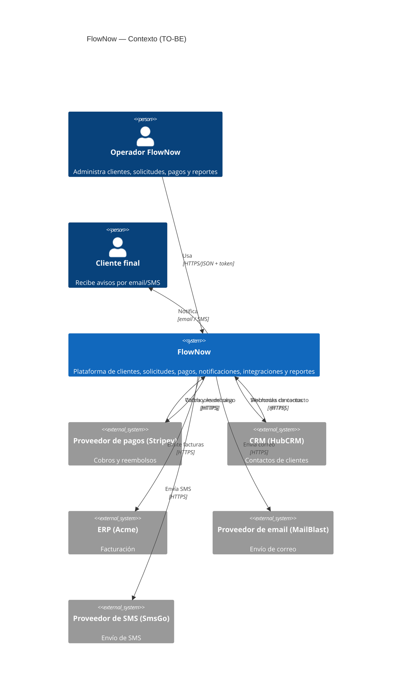
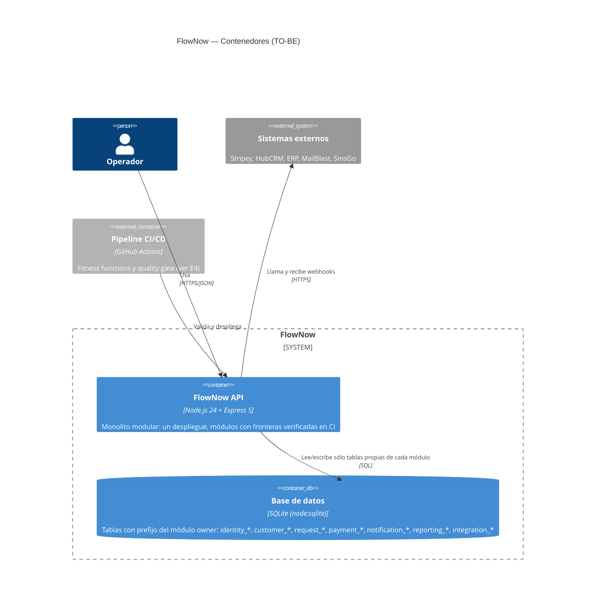
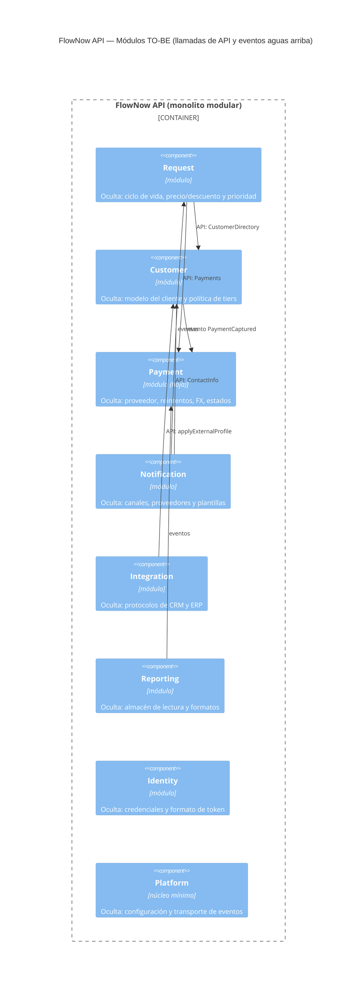
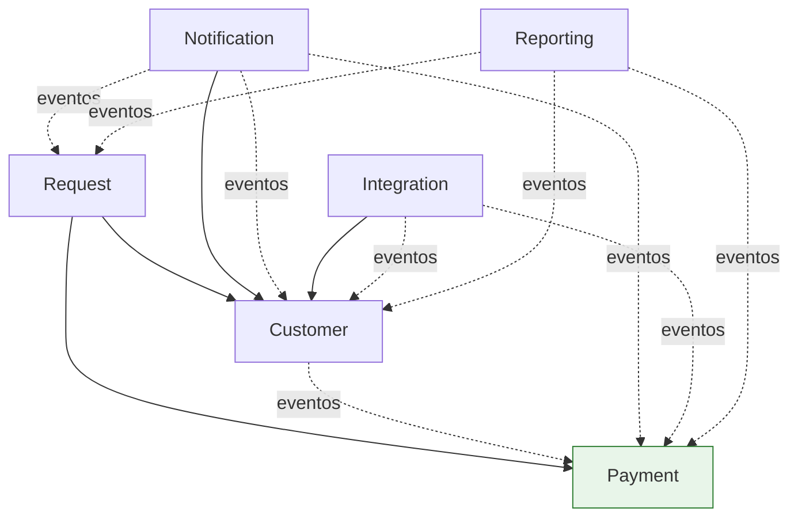
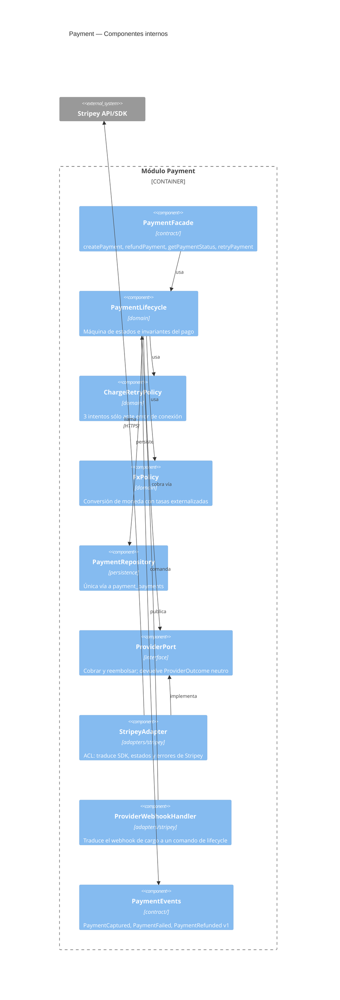
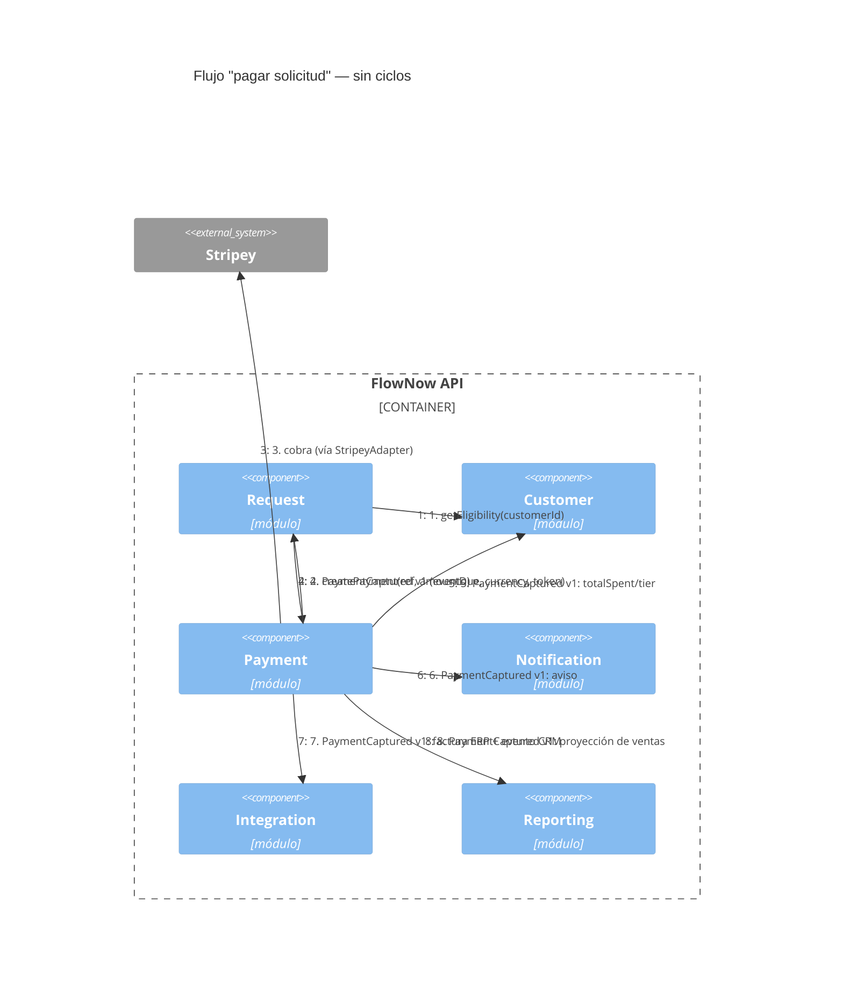
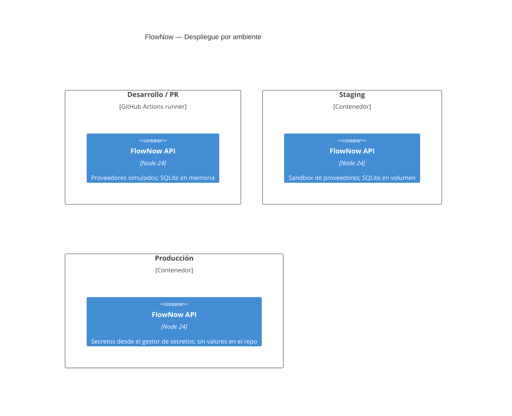

# E2. Arquitectura TO-BE basada en Parnas

> §17.2 · Cada módulo se define por la **decisión volátil que oculta**, no por capa técnica.
> Un Module Contract por módulo en [`modules/`](modules/) (plantilla Anexo A).
> **Estado:** diseño propuesto, aún no implementado. Las cifras del AS-IS vienen de `docs/baseline/as-is/resumen.md`; las del TO-BE son **metas** hasta que `scripts/baseline.sh` las mida (E8).

## 1. Drivers y de dónde sale cada decisión (§14.4)

| Driver | Qué significa aquí | Decisión que lo sirve |
|---|---|---|
| Modifiability | un cambio previsible toca ≈1 módulo | secretos por módulo (§3), adapters (ADR-003) |
| Maintainability | entender una responsabilidad sin leer todo | módulos con `contract/` pequeño; `processPayment` (CCN 26) se parte |
| Evolvability | sumar proveedores/canales sin reestructurar | `ProviderPort` en Payment, `ChannelPort` en Notification |
| Interoperability | integrar por contratos versionables | API pública + eventos versionados (ADR-004) |
| Testability | preservar comportamiento durante la recuperación | pruebas de caracterización primero (E3) |
| Data Ownership | una autoridad por dato | tablas con prefijo del owner + FF3 (ADR-002) |
| Bounded Complexity | ni módulos gigantes ni micro-fragmentación | monolito modular, 7 módulos + `platform` (ADR-006) |
| Traceability | problema → decisión → refactoring → evidencia | ADRs, Debt Ledger, intents, matriz E8 |

## 2. Hallazgos del AS-IS que motivan el diseño

Medidos con `scripts/baseline.sh` (`docs/baseline/as-is/`):

- **6 ciclos** entre servicios (`customer ↔ notification`, `customer ↔ request`, `request ↔ payment`, `payment ↔ notification`, `payment ↔ integration`, y uno de 3 nodos).
- **5 de 6 tablas** se escriben desde más de un archivo; **7 controllers** tocan tablas directo.
- El proveedor de pagos aparece en **12 archivos y 5 "módulos"** (S1); cambiar el modelo de Customer toca **13 archivos / 7 módulos** (S3).
- `processPayment`: 71 NLOC, CCN 26; 7,87 % de duplicación; cobertura de `paymentService` 18,9 %.

## 3. Nivel 1 — Contexto del sistema (C4)

El contexto no cambia respecto del AS-IS: lo que cambia es **quién dentro de FlowNow conoce a cada sistema externo** (nivel 3).

## 4. Nivel 2 — Contenedores (C4)

**Por qué un solo contenedor (§5).** El sistema mide ~700 LOC. Separarlo en servicios agregaría `C_coordination` (red, despliegue, consistencia) sin reducir `C_internal`. Las fronteras se imponen en el código y en CI; si más adelante un módulo (p. ej. Reporting) necesita escalar aparte, el contrato de eventos ya permite extraerlo. Ver [ADR-006](adr/ADR-006-monolito-modular-granularidad.md).

## 5. Nivel 3 — Componentes: los módulos (C4)

Todas las flechas apuntan a un **contrato público** (`modules/<m>/contract`), nunca a internos. Para que el diagrama sea legible se dibujan las llamadas de API y los eventos "aguas arriba" más relevantes; **la lista completa de dependencias (incluidas todas las suscripciones a eventos de Notification, Reporting e Integration) está en el grafo §5.1**. `Identity` la consume sólo el gateway HTTP y `Platform` todos los módulos (se omiten para no ensuciar).

### 5.1. Grafo de dependencias `G = (V, E)` y ausencia de ciclos

- **Hojas** (no dependen de nadie): `Payment`, `Identity`.
- **Orden topológico**: `Payment` → `Customer` → `Request` → {`Notification`, `Integration`, `Reporting`}. Las tres últimas son consumidoras "río abajo": nadie depende de ellas.
- **Ciclos eliminados**: `customer → notification` (bienvenida) y `customer → CRM` pasan a eventos; `payment → request/notification/integration` pasan a eventos que Payment publica sin conocer a los consumidores.
- Medición: FF1 (`dependency-cruiser`, `no-circular`) sobre `src/modules/**`. Meta: **0 ciclos** (AS-IS: 6).

| Módulo | Fan-in (quién lo usa) | Fan-out (de quién depende) |
|---|---|---|
| Payment | Request, Customer, Notification, Reporting, Integration | 0 |
| Customer | Request, Notification, Integration, Reporting | Payment (sólo eventos) |
| Request | Notification, Reporting | Customer, Payment |
| Notification / Reporting / Integration | 0 | 2–3 contratos |

## 6. Nivel 3 — Componentes internos del slice: Payment

**Qué se justifica y qué no (§9):**

| Elemento | ¿Por qué existe? (presión de cambio) |
|---|---|
| `ProviderPort` + `StripeyAdapter` | S1: cambiar de proveedor. Además ya hay una segunda variante real (`payfast`, hoy un `WORKAROUND` inline). Frontera + variabilidad + fake para pruebas. |
| `ChargeRetryPolicy`, `FxPolicy` | razones de cambio distintas del ciclo de vida: política de reintentos y tipo de cambio (hoy 950/1030 hard-coded y duplicados en reportes). |
| **Sin** `authorizePayment/capturePayment` | el proveedor cobra en un paso; exponerlos sería una interfaz sin variabilidad (§9). Si aparece un proveedor con dos fases, se agrega con ADR. |
| **Sin** `GatewayFactory` genérica | la selección es una línea de configuración (`payment.provider`); una factory con un `case` es la que hoy se critica. |

## 7. Vista dinámica: pagar una solicitud (C4)

Mismo comportamiento observable que `processPayment` del AS-IS (descuento, FX, reintentos, factura, aviso), pero repartido por razón de cambio y sin que Payment conozca a Request, Notification ni Integration.

## 8. Vista de despliegue (C4)

Los valores de ambiente (URLs de proveedores, claves, tasas FX, flags) se inyectan por variables de entorno/secretos; el repo sólo trae **defaults de desarrollo** en `platform/config` (FF5 vigila que no haya otros).

## 9. Módulos: responsabilidad, secreto, contrato y ownership

Detalle completo en las fichas [`modules/`](modules/) (Anexo A). Resumen:

| Módulo | Responsabilidad | Secreto de información (§3) | Contrato público | Ficha |
|---|---|---|---|---|
| **Identity** | Autenticar operadores | esquema de credenciales y formato/firma del token | `authenticate()`, `verifyToken()` | [identity](modules/identity.md) |
| **Customer** | Gobernar al cliente y su ciclo de vida | modelo de datos del cliente, política de tiers, reglas de fusión | `CustomerDirectory`: `get`, `register`, `update`, `merge`, `getContactInfo`, `isEligible` · eventos `CustomerRegistered`, `CustomerProfileChanged` | [customer](modules/customer.md) |
| **Request** | Gobernar solicitudes y su pago | máquina de estados, precio/descuento y prioridad | `createRequest`, `changeStatus`, `cancel`, `payRequest` · eventos `RequestCreated`, `RequestStatusChanged`, `RequestCancelled` | [request](modules/request.md) |
| **Payment** | Ciclo de vida del pago | proveedor, tokenización, reintentos, FX, mapeo de errores, persistencia | `createPayment`, `refundPayment`, `retryPayment`, `getPaymentStatus` · eventos `PaymentCaptured`, `PaymentFailed`, `PaymentRefunded` | [payment](modules/payment.md) |
| **Notification** | Comunicar a los clientes | canales, proveedores de entrega, plantillas, política de envío | `send`, `broadcast` · consume eventos | [notification](modules/notification.md) |
| **Reporting** | Informar sin tocar lo operativo | almacén de lectura (proyecciones) y formatos CSV/JSON | `salesReport`, `customersReport`, `requestsReport`, `dashboard` | [reporting](modules/reporting.md) |
| **Integration** | Hablar con CRM y ERP | protocolos, mapeos y reintentos de HubCRM y ERP | `handleCrmWebhook` (entrada) · consume eventos | [integration](modules/integration.md) |
| **Platform** | Infraestructura transversal mínima | fuente de configuración y transporte de eventos | `config`, `eventBus`, `Money` | [platform](modules/platform.md) |

**Módulos descartados o fusionados:**

- **`utils/helpers`** desaparece: cada función va al módulo cuyo secreto la justifica (`formatMoney` → `Money`/Reporting, `tierDiscount` → Customer/Request, `sendEmail` → Notification, `httpPost`/`retry` → cada adapter, tokens → Identity).
- **`GatewayFactory`, `INotifier`, `IPaymentGateway` genéricos**: reemplazados por puertos con frontera real (`ProviderPort`, `ChannelPort`) dentro de su módulo.
- **Un módulo "Stripey/Provider" aparte**: rechazado. El proveedor es un secreto *de Payment*, no un módulo; vive en `payment/adapters/`.
- **Fusionar Integration en Customer/Payment**: rechazado: CRM y ERP cambian por razones distintas a las del cliente o el pago. Si hubiera que simplificar (pregunta 2 de §20), Integration es el candidato a fusionarse con Platform/outbox antes que Notification.

## 10. Ownership de datos (§6.1)

| Dato | Owner | Tabla(s) | Lectura por otros | Escritura |
|---|---|---|---|---|
| Usuario/credencial | Identity | `identity_users` | sólo vía `verifyToken` | Identity |
| Cliente | Customer | `customer_customers` | `CustomerDirectory` (API/DTO) y eventos | Customer |
| Total gastado, tier | Customer | `customer_customers` | API | Customer (reacciona a `PaymentCaptured`) |
| Solicitud | Request | `request_requests` | API y eventos | Request |
| Pago / transacción | Payment | `payment_payments` | `getPaymentStatus` y eventos | Payment |
| Notificación enviada | Notification | `notification_log` | consulta de auditoría | Notification |
| Proyecciones de reporte | Reporting | `reporting_sales`, `reporting_customers`, `reporting_requests` | formatos de reporte | Reporting (desde eventos) |
| Bitácora de integración | Integration | `integration_log` | consulta | Integration |

Cada tabla lleva el prefijo de su owner; FF3 verifica que ningún archivo fuera de `modules/<owner>/` mencione tablas `<owner>_*`. **Datos sin owner: 0** (AS-IS: 5 de 6 tablas con escritores múltiples).

## 11. Contratos e interoperabilidad (§6.2)

| Contrato | Tipo | Proveedor | Consumidores | Versionado | Compatibilidad |
|---|---|---|---|---|---|
| `CustomerDirectory` | API (fachada TS/JS + DTO `CustomerSummary`, `ContactInfo`) | Customer | Request, Notification, Integration | `contract/v1`; cambios incompatibles ⇒ `v2` coexistiendo un ciclo | sólo se agregan campos opcionales en `v1` |
| `Payments` | API + DTO `CreatePayment`, `PaymentView` | Payment | Request | `contract/v1` | ídem |
| `CustomerRegistered`, `CustomerProfileChanged` | evento | Customer | Notification, Integration, Reporting | campo `schemaVersion` en cada evento | consumidores ignoran campos desconocidos |
| `RequestCreated`, `RequestStatusChanged`, `RequestCancelled` | evento | Request | Notification, Reporting | `schemaVersion` | ídem |
| `PaymentCaptured`, `PaymentFailed`, `PaymentRefunded`, `PaymentActionRequired` | evento | Payment | Request, Customer, Notification, Integration, Reporting | `schemaVersion`; payload **sin** campos del proveedor | ídem |
| Webhooks HTTP entrantes (`/integrations/webhook/crm`, `/payments/webhooks/provider`) | API HTTP | Integration / Payment (adapter) | sistemas externos | URL versionada | validados y traducidos en la frontera (ACL) |
| `ProviderPort` | puerto interno | Payment | `StripeyAdapter` (y, si procede, un adapter de respaldo) | interno, sin versionado público | cambia sólo con ADR-003 |

Los eventos se declaran como **JSON Schema** en `modules/<m>/contract/events/*.schema.json`; una prueba de contrato valida que cada publicador emite conforme al schema y que cada consumidor tolera campos extra.

## 12. Dependencias permitidas / prohibidas

| Módulo | Permitidas | Prohibidas | Fitness function |
|---|---|---|---|
| Payment | `platform` | cualquier otro módulo (ni su BD ni sus contratos) | FF1, FF2, FF3, FF6 |
| Customer | `platform`, eventos de Payment | Request, Notification, Integration, Reporting | FF1, FF3, FF6 |
| Request | `platform`, `customer/contract`, `payment/contract` | tablas `customer_*`/`payment_*`; Notification | FF3, FF6 |
| Notification | `platform`, `customer/contract` (ContactInfo), eventos | tablas ajenas; tipos de Payment fuera del evento | FF3, FF6 |
| Reporting | `platform`, eventos | **cualquier tabla ajena** (lee sólo sus proyecciones) | FF3, FF6 |
| Integration | `platform`, `customer/contract`, eventos | tablas ajenas | FF3, FF6 |
| Identity | `platform` | todo lo demás | FF6 |
| Todos | — | importar internos de otro módulo; nombres de proveedor fuera de su adapter; URLs/secretos literales | FF2, FF5, FF6 |

## 13. Invariantes

- **Payment:** un pago `paid` no se vuelve a cobrar; `refunded_amount ≤ amount`; sólo se reembolsa un pago `paid`; máx. 3 intentos de cobro ante error de conexión; un pago `failed/error` admite a lo sumo 3 reintentos por solicitud.
- **Request:** transiciones válidas `new→{in_progress,cancelled}`, `in_progress→{done,cancelled}`; no se cierra (`done`) sin pago; máx. 10 solicitudes abiertas por cliente; monto > 0.
- **Customer:** email único; no se opera con clientes `inactive`/`merged`; `totalSpent` sólo cambia por eventos de pago.
- **Notification:** cada envío queda registrado; ningún mensaje al cliente nombra al proveedor de pagos.
- **Reporting:** nunca consulta tablas de otro módulo; los montos se agregan en moneda base usando el valor que Payment emite en el evento (una sola fuente de FX).
- **Integration:** toda llamada externa queda en `integration_log`; un fallo de CRM/ERP no revierte el pago.
- **Global:** el grafo de módulos es acíclico; no existe SATD sin `TD-xxx`.

Cada invariante se traduce en pruebas de caracterización (E3) y las del grafo/ownership en FF1–FF6 (E4).

## 14. Justificación de granularidad (§5)

`C_total = C_internal + C_coordination`.

| Opción | C_internal | C_coordination | Veredicto |
|---|---|---|---|
| Estado actual (`controllers/services/utils`) | alto: `processPayment` CCN 26, `helpers` mezcla 8 responsabilidades | oculto: 6 ciclos, 5 tablas compartidas | rechazada |
| 3 módulos gruesos (p. ej. Core, Money, Comms) | medio | bajo | mezcla razones de cambio (Request+Customer+Identity) |
| **7 módulos + `platform` (propuesta)** | cada módulo con 1 razón de cambio dominante | 13 aristas dirigidas, 0 ciclos; contratos pequeños | **elegida** |
| Microservicios por módulo | bajo | alto: red, consistencia, despliegue ×7, para ~700 LOC | rechazada (ADR-006) |
| Un módulo por clase/función | mínimo | explosión de interfaces | rechazada (§5, anti-patrón evaluativo) |

Criterio operativo: un módulo existe si (a) oculta una decisión volátil concreta, (b) posee datos propios y (c) puede probarse con su contrato. `Identity` es el caso límite (poco código); se conserva porque su secreto (token/credenciales) cambia por razones de seguridad independientes y hoy está mezclado con `helpers`.

## 15. Patrones y SOLID aplicados (con su problema)

| Problema de cambio | Patrón / principio | Trade-off | Alternativa rechazada |
|---|---|---|---|
| Múltiples proveedores de pago (S1) | **Adapter/ACL + Strategy** (`ProviderPort`) / **DIP**: la política de pago depende del puerto | una indirección más; se paga con un fake que habilita pruebas sin red | `GatewayFactory` con `switch` (OCP violado y sin variabilidad real) |
| Canales de notificación (S2) | **Strategy** (`ChannelPort`: email, SMS, futuro WhatsApp) / **OCP** | tabla de canales por configuración | `if (config.enableSms)` repartido |
| Reacciones desacopladas al pago | **Pub-Sub** (eventos versionados) | entrega en proceso, sin garantía ante caída; mitigación: bitácora + reintento (TD-009) | llamadas directas entre servicios (los 6 ciclos de hoy) |
| Dinero y moneda primitivos | **Value Object** `Money` (monto menor + moneda) | pequeña conversión en bordes | `Number` suelto con `* 950` |
| `processPayment` monolítico | **Extract Method/Class** → `PaymentLifecycle`, `ChargeRetryPolicy`, `FxPolicy` (**SRP**) | más archivos, mejor localización | dejarlo y comentar |
| Reglas de descuento/prioridad duplicadas | Mover a `Request` (única razón de cambio: política comercial) | Request conoce `tier` vía DTO | duplicar en controller (hoy) |
| Interfaz con una sola implementación (`IPaymentGateway`, `INotifier`) | **Eliminar o justificar** | `INotifier` se reemplaza por `ChannelPort` con ≥2 canales reales | conservarla "por SOLID" |

**Patrones rechazados explícitamente:** Factory abstracta de proveedores (sin variabilidad que la pida), CQRS/Event Sourcing (sobredimensionado para 7 módulos y ~700 LOC), saga/orquestador distribuido (un solo proceso y una BD), repositorio genérico por entidad (indirección sin variabilidad).

## 16. Riesgos y dependencias que siguen abiertas

| Riesgo | Por qué | Mitigación |
|---|---|---|
| `Customer ⇢ Payment` (evento) | Customer actualiza `totalSpent`/tier al cobrar; si el contrato cambia, Customer cambia | contrato `v1` versionado; prueba de contrato; el sentido de la flecha se mantiene (nunca `Payment → Customer`) |
| Eventos en proceso | sin garantía de entrega ante caída entre commit y publicación | TD-009 (aceptada, con outbox como evolución); bitácora de eventos |
| Regla comercial "bono gold −5000" (HACK) | regla de negocio sin dueño claro | se traslada a `Request` (pricing) con TD-003 hasta confirmar con el negocio |
| Un solo `SQLite` compartido | la separación es lógica, no física | FF3 + prefijos; la física es decisión futura (ADR-002) |
