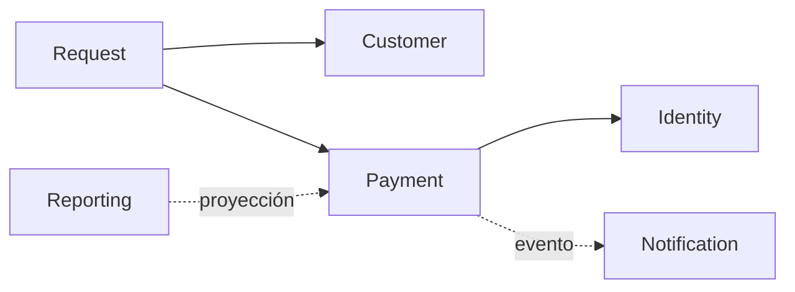

# E2. Arquitectura TO-BE basada en Parnas

> §17.2 · Cada módulo se define por la **decisión volátil que oculta**, no por capa técnica.
> Un Module Contract por módulo en [`modules/`](modules/) (plantilla Anexo A).

## 1. Drivers (§14.4)

Maintainability · Modifiability · Evolvability · Interoperability · Testability · Data Ownership · Bounded Complexity · Traceability.

## 2. Módulos propuestos

Hipótesis inicial (§4.1), ajustar con evidencia:

| Módulo | Responsabilidad | Secreto de información | Contrato | Ficha |
|---|---|---|---|---|
| Identity | | | | [identity](modules/identity.md) |
| Customer | | | | [customer](modules/customer.md) |
| Request | | | | [request](modules/request.md) |
| Payment | Ciclo de vida del pago | Proveedor, tokenización, reintentos, mapeo de errores | `createPayment()`… | [payment](modules/payment.md) |
| Notification | | | | [notification](modules/notification.md) |
| Reporting | | | | [reporting](modules/reporting.md) |
| Integration | | | | [integration](modules/integration.md) |

Módulos descartados o fusionados (y por qué):

-

## 3. Ownership de datos (§6.1)

| Dato | Owner | Lectura por otros | Escritura |
|---|---|---|---|
| Customer | Customer | API / proyección | Customer |
| Payment | Payment | API / evento | Payment |
| Request | Request | API / evento | Request |
| Notification | Notification | auditoría / consulta | Notification |

## 4. Contratos e interoperabilidad (§6.2)

| Contrato | Tipo (API/evento/DTO/schema) | Proveedor | Consumidores | Versionado | Compatibilidad |
|---|---|---|---|---|---|
| | | | | | |

## 5. Grafo de dependencias TO-BE

<!-- Reemplazar por el grafo real. Debe ser acíclico. -->

## 6. Dependencias permitidas / prohibidas

| Módulo | Permitidas | Prohibidas | Fitness function |
|---|---|---|---|
| Payment | CustomerIdentity API | Customer DB, Notification impl., Reporting DB | FF1, FF2, FF3 |

## 7. Invariantes

-

## 8. Justificación de granularidad (§5)

`C_total = C_internal + C_coordination`. Explicar por qué este número de módulos equilibra ambas.

## 9. Patrones y SOLID aplicados

| Problema de cambio | Patrón / principio | Trade-off | Alternativa rechazada |
|---|---|---|---|
| Múltiples proveedores de pago | Strategy / Adapter | | |
