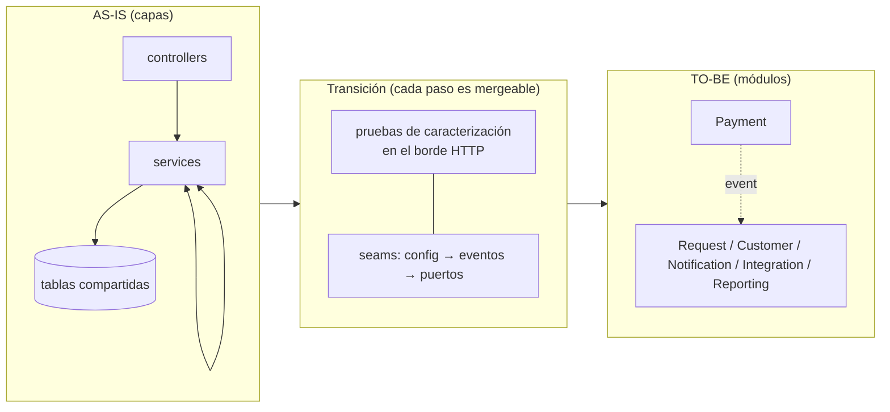
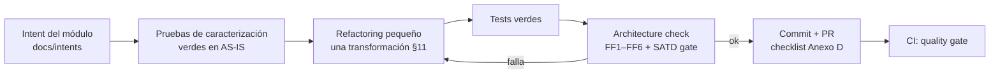
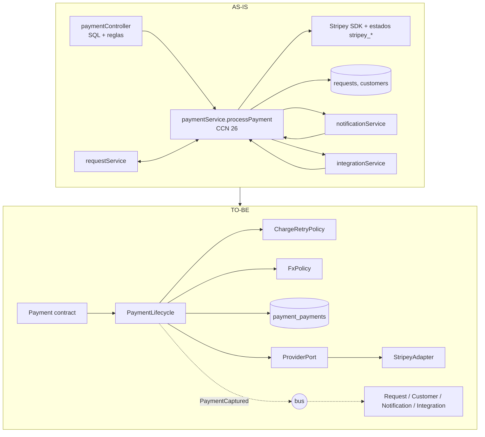
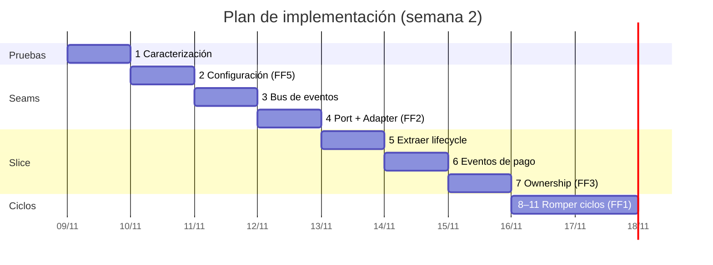
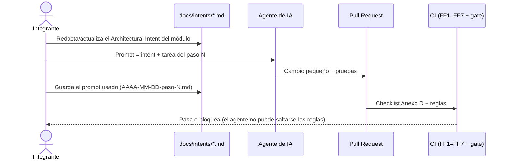

# E3. Plan e implementación de refactoring

> §17.3, §11, §15 pasos 7–8 · Sin reescritura. Ciclo por paso:
> `CharacterizationTests → SmallRefactoring → Tests → ArchitectureCheck → Commit`
> **Estado:** plan de diseño. Las columnas "Commit/PR" y "Resultado" se completan al ejecutar; ninguna cifra de resultado se anticipa aquí.

**Slice elegido:** Payment **y los ciclos que lo rodean**. **Justificación:** (1) S1 (cambio de proveedor) es el escenario con mayor radio (12 archivos); (2) concentra 5 de las 8 deudas SATD y el método más complejo (`processPayment`, CCN 26); (3) 3 de los 6 ciclos pasan por `paymentService`; (4) permite demostrar adapter, ownership y eventos en un solo recorrido; (5) los 3 ciclos restantes (Customer↔Notification, Customer↔Request y el de 3 nodos) se rompen con la misma técnica y son necesarios para el gate "ciclos = 0".

## 1. Estrategia: strangler interno, un seam por vez

- El **borde HTTP es la red de seguridad**: las pruebas de caracterización llaman a la API real (Express en puerto efímero, SQLite en memoria, proveedores simulados). Así pueden mover código por dentro sin cambiar las pruebas.
- Cada paso deja el sistema funcionando y es un commit/PR pequeño. No hay rama larga de "reescritura".
- Orden de **menor a mayor riesgo**, y las fitness functions se activan **cuando el paso que las hace verdaderas termina** (ratchet): nunca se apaga una regla ya encendida.

## 2. Ciclo por paso (qué se exige antes de commitear)

## 3. Pruebas de caracterización (paso 1, cierra TD-008)

**Implementadas en el paso 1** (`flownow/test/characterization/`: `payments`, `refunds-retries`, `requests`, `customers`, `webhooks`, `reports`, `auth`; arnés en `test/support/harness.js`). Black-box sobre la API. Cada fila es una prueba que debe estar **verde contra el AS-IS antes de tocar código** y seguir verde después. Las aserciones usan valores esperados explícitos (no se "aprueba" ciegamente la salida actual) y no dependen de ids ni timestamps.

| Comportamiento (invariante) | Prueba | Antes | Después |
|---|---|---|---|
| Pago aprobado: `paid`, solicitud `paid=1`, `erp_invoice` seteada, 1 intento | `POST /payments` con `tok_ok` | ✅ verde en AS-IS | ✅ |
| Descuento por tier aplicado al monto (silver 10 %, gold 15 %) | solicitud + pago | ✅ verde en AS-IS | ✅ |
| Bono gold −5000 si monto > 1.000.000 (TD-003) | pago gold grande | ✅ verde en AS-IS | ✅ |
| Conversión USD ÷950, EUR ÷1030, redondeo a 2 decimales (TD-002) | pago con `currency` | ✅ verde en AS-IS | ✅ |
| Rechazo: `failed`, solicitud sin pagar, aviso "rechazado" | `tok_declined` | ✅ verde en AS-IS | ✅ |
| 3DS: `pending_action`, aviso "acción adicional" | `tok_3ds` | ✅ verde en AS-IS | ✅ |
| Timeout: 3 intentos, `error`, HTTP 502 | `tok_timeout` | ✅ verde en AS-IS | ✅ |
| Doble pago: 409 `solicitud ya pagada` | repetir pago | ✅ verde en AS-IS | ✅ |
| Moneda no soportada / cliente inactivo / solicitud cancelada: 400 | validaciones | ✅ verde en AS-IS | ✅ |
| Reembolso parcial → `paid`; total → `refunded`; excedido → 400; no pagado → 400 | `POST /payments/:id/refund` | ✅ verde en AS-IS | ✅ |
| Reintento: sólo `failed/error`, máx. 3, el anterior pasa a `superseded` | `POST /payments/:id/retry` | ✅ verde en AS-IS | ✅ |
| Cancelar solicitud pagada reembolsa y decrementa abiertas | `POST /requests/:id/cancel` | ✅ verde en AS-IS | ✅ |
| `done` exige pago; transiciones inválidas → 400 | `POST /requests/:id/status` | ✅ verde en AS-IS | ✅ |
| Umbral gold: `total_spent` acumulado > 2.000.000 promueve a gold | pagos sucesivos | ✅ verde en AS-IS | ✅ |
| Efectos: aviso al cliente, factura ERP, evento a CRM (en `outbox`/bitácora) | tras pago ok | ✅ verde en AS-IS | ✅ |
| Webhook de proveedor `charge.succeeded/failed` actualiza pago y solicitud | `POST /integrations/webhook/stripey` | ✅ verde en AS-IS | ✅ |
| Webhook CRM `contact.updated/deleted` | `POST /integrations/webhook/crm` | ✅ verde en AS-IS | ✅ |
| Reporte de ventas: totales por tier/proveedor/moneda en CLP | `GET /reports/sales` | ✅ verde en AS-IS | ✅ |
| Alta de cliente: validaciones, duplicado 409, sync CRM, bienvenida | ✅ verde en AS-IS | ✅ |

Meta de cobertura (FF7): `paymentService`/futuro `modules/payment` ≥ 80 % líneas (hoy 18,9 %), medida por `baseline.sh`.

### Resultado del paso 1 (medido)

- **46 pruebas verdes** sobre el código AS-IS **sin modificar `src/`** (3 corridas consecutivas estables); antes eran 5.
- Cobertura de líneas (`docs/baseline/paso1/cobertura.txt`): `paymentService` **18,9 % → 100 %**, `integrationService` 39,0 % → 100 %, `requestService` 42,2 % → 100 %, global 56,4 % → 98,2 %. Ahora el reporte incluye los controllers (antes ninguna prueba los cargaba).
- Hallazgos de la caracterización (comportamiento actual que se **preserva** salvo decisión explícita):
  1. El límite de 3 reintentos nunca se alcanza encadenando `retry` (cada reintento marca el anterior `superseded`); sólo con 3 cobros fallidos directos sobre la misma solicitud.
  2. `customers.total_spent` suma el monto en la moneda del pago **sin convertir a CLP** (100 USD cuentan como 100): defecto del AS-IS, visible en `GET /reports/customers`.
  3. Los avisos de pago nombran al proveedor ("procesado por Stripey"). **No se fijó en las pruebas**: el TO-BE lo elimina a propósito (invariante de Notification). Es el único cambio de comportamiento observable previsto, además de la lista de compatibilidad TD-010; ambos requieren aprobación y quedan registrados en el ADR correspondiente.
  4. Los webhooks entrantes no exigen token (se caracteriza; la validación de origen es mejora futura, no parte del slice).

## 4. Secuencia incremental

| # | Transformación (§11) | Qué se hace | Deuda | Riesgo | FF que se enciende |
|---|---|---|---|---|---|
| 1 ✅ | **Characterization tests** | suite black-box de §3 sobre el AS-IS (hecho: 46 pruebas) | TD-008 (cerrada) | bajo | FF7 (umbral de cobertura crítica) |
| 2 ✅ | **HardcodedValue → Configuration** | `platform/config` (env + defaults de desarrollo): claves, URLs, tasas FX, flags, secreto de firma | TD-006, parte de TD-002, H-1..H-4 | bajo | **FF5** |
| 3 ✅ | **Seam: bus de eventos** | `platform/events` con `schemaVersion`, aislamiento de fallos y pruebas | TD-009 (registrar) | bajo | — |
| 4 ✅ | **DirectVendorDependency → Port + Adapter** | `ProviderPort` + `StripeyAdapter` (ACL de estados/errores); respaldo PayFast como segundo adapter; se elimina `GatewayFactory`/`IPaymentGateway`/`INotifier` triviales | TD-005 | medio | **FF2**, FF2b |
| 5 ✅ | **LargeMethod → ExtractClass** | `processPayment` → `PaymentLifecycle` + `ChargeRetryPolicy` + `FxPolicy` (funciones puras con pruebas unitarias) | TD-002 | medio | umbral de complejidad (CCN ≤ 10 en el módulo) |
| 6 ✅ | **SharedDataMutation → OwnershipBoundary (eventos)** | Payment publica `PaymentCaptured/Failed/Refunded`; **Request** marca `paid` y **Customer** actualiza `totalSpent`/tier por suscripción; Payment deja de escribir `requests`/`customers`. *Rompe el ciclo Request↔Payment* | — | **alto** | — |
| 7 ✅ | **Ownership de tabla** | `PaymentRepository` única vía a `payment_payments` (renombre `payments` → `payment_payments`, `stripey_*` → `provider_*`); presentador HTTP de compatibilidad para los campos legacy | TD-010 | medio | **FF3** (ratchet: `payment_*`, `customer_*`) |
| 8 ✅ | **Efectos laterales por eventos** | Notification e Integration suscritos al pago (aviso; factura ERP; evento CRM); se retiran las llamadas directas. *Rompe Payment↔Notification y Payment↔Integration* | TD-004 | medio | — |
| 9 ✅ | **Orquestación en Request** | `Request.payRequest` descuenta, valida y llama `Payments.createPayment`; `paymentController` queda como adaptador HTTP delgado (sin SQL) | — | medio | FF6 (fronteras por `contract/`) |
| 10 | **Romper Customer↔Notification** | bienvenida por `CustomerRegistered`; sync CRM sale de Customer (Integration lo hace con reintento) | TD-001 | medio | — |
| 11 | **Romper Customer↔Request** | `open_requests` deja de calcularse en Customer: el gateway HTTP compone `CustomerDirectory.get` + `Requests.countOpen` (API composition). *Rompe los 2 ciclos restantes* | — | medio | **FF1** sobre todo el grafo |
| 12 | **Reporting por proyecciones (alcance ampliado, si hay tiempo)** | `salesReport` lee `reporting_sales` alimentada por eventos; FX sale (usa `amountBase`) | TD-007 | medio | FF3 se amplía a `reporting_*` |

**Predicción de ciclos por paso** (hipótesis de diseño; cada valor se verifica con FF1/`dependencias.json` al ejecutar el paso):

| Tras el paso | 0 | 6 | 8 | 10 | 11 |
|---|---|---|---|---|---|
| Ciclos | 6 | 5 | 3 | 2 | **0** |
| Ciclo que desaparece | — | Request↔Payment | Payment↔Notification, Payment↔Integration | Customer↔Notification | Customer↔Request y el de 3 nodos |

### 4.1. Antes y después del slice Payment

### 4.2. Resultado del paso 2 (medido)

`HardcodedValue → Configuration`: nuevo `src/platform/config.js` (lectura perezosa de variables de entorno, defaults **no secretos** sólo para desarrollo, claves obligatorias con `NODE_ENV=production`). Se retiró `src/config.js` y se eliminaron del resto del código las URLs de proveedores, claves, secreto de firma, credencial admin, remitente de correo y tasas FX.

| Indicador | Antes del paso 2 | Después | Cómo se midió |
|---|---|---|---|
| FF5 (valores fijos en `src/`) | **22 violaciones** (9 URL, 6 FX, 3 clave, 3 correo, 1 secreto) | **0** | `node ci/rules/no-hardcoded.js` sobre `git archive 3a3eb9f` y sobre el árbol actual |
| SATD sin gestionar | 7 | **0** (los 6 marcadores restantes citan su `TD-xxx`; el de `config.js` se resolvió y se retiró) | `scripts/satd-scan.sh --gate` + `ci/rules/ledger-consistency.js` |
| Pruebas | 46 | **50** verdes (4 nuevas de `config`); la suite de caracterización pasa **sin cambios** | `npm test` |
| Cobertura global | 98,2 % | 98,3 % | `docs/baseline/paso2/` |

Las 5 líneas con URLs y 4 con "posibles secretos" que aún muestra `baseline.sh` están **sólo** en `platform/config.js` (el único lugar permitido). Verificado además: con `NODE_ENV=production` y sin variables, la app **no arranca** (falla con "Falta la variable de entorno …"); con las variables, `admin123` deja de funcionar y sólo entra la contraseña configurada.

Efecto de comportamiento: ninguno con la configuración por defecto (la suite de caracterización lo demuestra). El secreto de firma por defecto cambió (`dev-only-token-secret`), lo que sólo invalida tokens ya emitidos.

### 4.3. Resultado del paso 3 (medido)

`platform/events.js`: bus en proceso con sobre versionado (`id`, `type`, `schemaVersion`, `occurredAt`, `payload` inmutable), `subscribe`/`publish`, contratos mínimos por versión (`registerContract`: campos requeridos y tipos, lector tolerante) y **aislamiento de fallos** (un consumidor que falla no impide a los demás ni rompe al publicador; queda en la bitácora acotada `deadLetters()`).

- **12 pruebas nuevas** (`test/platform/events.test.js`): orden de entrega, sobre, aislamiento (síncrono y asíncrono), espera de consumidores async, desuscripción, reentrancia, contrato (campos mínimos/extra/inválido sin entrega), convivencia de v1 y v2, argumentos inválidos, tope de la bitácora. Total: **62 verdes**; la suite de caracterización sigue sin cambios. Cobertura de `events.js`: 100 % líneas.
- `publish` **espera** a los consumidores: así, cuando los pasos 6 y 8 muevan los efectos del pago a eventos, el flujo HTTP conserva su comportamiento (los efectos ocurren antes de responder).
- **Sin cambio de comportamiento:** el bus todavía no está conectado a ningún flujo (es el *seam*; se usa desde el paso 6). No es una abstracción sin presión de cambio: existe para romper los ciclos de ADR-004 y se prueba por separado antes de depender de él.
- TD-009 queda **implementada como mitigación** (bitácora de fallos) y verificada con las pruebas de aislamiento; el outbox sigue siendo evolución futura aceptada.

### 4.4. Resultado del paso 4 (medido)

`DirectVendorDependency → Interface + Adapter` en `src/modules/payment/`:

- **Puerto** de proveedor de pagos (`charge`, `refund`, `parseWebhook`) con vocabulario del dominio (`captured | declined | action_required | unknown`) y errores neutros (`ProviderError`, `ProviderUnavailableError` reintentable). `providers/index.js` elige el proveedor por configuración (`active()`, `forRefund()`, `byName()`); **no** es una factory genérica: hay dos variantes reales.
- **Adapters** `adapters/stripey` (ACL: único archivo que importa el SDK y conoce sus estados y errores) y `adapters/payfast` (antes, código inline marcado `WORKAROUND`; cierra el núcleo de TD-005).
- `paymentService.processPayment` ya no conoce tipos ni errores del proveedor: usa el puerto y un único bucle de cobro. **Se eliminaron** `IPaymentGateway`, `GatewayFactory`, `StripeyGateway` e `INotifier`/`EmailNotifier` (interfaces con una sola implementación).
- La traducción del webhook entrante se movió al adapter (`parseWebhook`).

| Indicador | Antes (`aa782aa`) | Después | Cómo se midió |
|---|---|---|---|
| FF2: archivos que importan el SDK fuera del adapter | **1** (`StripeyGateway.js`; la regla detecta la violación sobre el código previo) | **0** | `node ci/rules/arch.js` |
| FF2b: archivos fuera de adapters/config/registro que nombran a Stripey/PayFast | **10** | **8** (ratchet; seguirá bajando en los pasos 6, 7 y 8) | `node ci/rules/provider-names.js` |
| `processPayment` | 71 NLOC · CCN 26 | 64 NLOC · CCN **23** | `baseline.sh` (lizard) |
| Interfaces triviales | 5 archivos en `services/interfaces/` | **0** | — |
| Pruebas | 63 | **72** verdes (9 nuevas: contrato del puerto para ambos adapters) | `npm test` |
| Ciclos | 6 | 6 (sin cambio; se rompen en los pasos 6, 8, 10 y 11) | FF1 con ratchet |

**Honestidad sobre S1:** el escenario "cambiar de proveedor" **aún no mejora** en la heurística (12 archivos antes y después), porque las columnas `stripey_*`, los avisos y el webhook siguen en el AS-IS hasta los pasos 7 y 8. Lo que ya cambió es la **frontera**: ningún archivo fuera del adapter importa el SDK ni interpreta sus estados o errores, y FF2 lo impide en CI.

**Único cambio de comportamiento observable:** la ruta de respaldo PayFast ahora pasa por el mismo bucle de cobro y registra `attempts = 1` (antes 0), y un error de red de PayFast se trata como falla del proveedor (502) en lugar de excepción sin controlar. La prueba de caracterización quedó fijada antes del cambio y se actualizó con el motivo.

### 4.5. Resultado del paso 5 (medido)

`LargeMethod → ExtractClass` sobre `processPayment`. Nuevas piezas puras en `src/modules/payment/domain/` (no tocan base ni proveedor):

| Pieza | Razón de cambio | Contenido |
|---|---|---|
| `fx-policy` (FxPolicy) | tipo de cambio y monedas aceptadas | `isSupported`, `fromClp`, `toClp`, `round2` |
| `charge-retry-policy` (ChargeRetryPolicy) | cuántos reintentos y ante qué fallas | `chargeWithRetry` (reintenta sólo `ProviderUnavailableError`, máx. 3) |
| `payment-lifecycle` (PaymentLifecycle) | estados e invariantes del pago | `statusFor`, `assertPayable`, `planRefund`, `isRetryable` |
| `amount-due` | política comercial **(temporal: es de Request, se mueve en el paso 9)** | descuento por tier y bono gold (TD-003) |

`paymentService.processPayment` queda como orquestador de pasos con una sola razón de cambio cada uno (`loadPayable`, `insertPending`, `recordOutcome`, `failUnreachable`, `settleCaptured`). `paymentController` y `reportService` reutilizan `FxPolicy` (ya no repiten la conversión 950/1030).

| Indicador | Antes (paso 4) | Después | Cómo se midió |
|---|---|---|---|
| `processPayment` | 64 NLOC · CCN **23** | **17 NLOC · CCN 4** | lizard (`docs/baseline/paso5/complejidad.csv`) |
| Función más compleja de Payment | CCN 23 | **CCN 6** (`chargeWithRetry`, `assertPayable`) | ídem |
| CCN máximo del sistema | 26 (AS-IS) | **14** (`salesReport`, fuera del slice) | `resumen.md` |
| Funciones con CCN > 10 | 3 | 3 (`salesReport` 14, `bulkCreate` 12 y `events.publish` 12*) | `resumen.md` |
| Duplicación | 7,68 % | **6,69 %** | jscpd |
| Pruebas | 72 | **92** verdes (20 unitarias de dominio, sin base ni red) | `npm test` |

\* `events.publish` (CCN 12) es código nuevo del paso 3 con validaciones de argumentos; FF8 exigirá ≤ 10 en el alcance intervenido, así que queda como ajuste pendiente de ese paso (partir `publish` en `validate` + `deliver`).

**Sin cambio de comportamiento:** la suite de caracterización (63 pruebas del flujo HTTP) pasa **sin modificaciones**. Se preservaron el orden de validación, el orden de las escrituras y el log de reintentos (que también se emite tras el último intento fallido).

### 4.6. Resultado del paso 6 (medido)

`SharedDataMutation → OwnershipBoundary`: Payment deja de escribir en tablas ajenas y publica eventos de contrato versionado (`modules/payment/contract/events.js`: `Payment.Captured` y `Payment.Refunded` v1, sin campos del proveedor). Los dueños reaccionan:

| Consumidor | Reacciona a | Efecto (antes lo hacía `paymentService`) |
|---|---|---|
| Request (`modules/request/subscriptions.js`) | `Payment.Captured` · `Integration.InvoiceIssued` | marca `requests.paid` · adjunta `requests.erp_invoice` |
| Customer (`modules/customer/subscriptions.js`) | `Payment.Captured` · `Payment.Refunded` | `total_spent` y promoción a gold (publica `Customer.TierChanged`) |
| Integration (`modules/integration/subscriptions.js`) | `Payment.Captured` · `Customer.TierChanged` | factura en el ERP (publica `Integration.InvoiceIssued`) · actualiza el tier en el CRM |

`server.js` es la raíz de composición: registra las suscripciones en el orden de efectos del AS-IS. La respuesta HTTP del cobro sigue incluyendo la solicitud actualizada, pero se compone en `paymentController` (el borde), de modo que `paymentService` **ya no importa** `requestService`.

| Indicador | Antes (paso 5) | Después | Cómo se midió |
|---|---|---|---|
| Escrituras de `paymentService` a tablas ajenas | **5** (`customers` ×3, `requests` ×2) | **0** | `scripts/data-access.js` sobre `5c222a2` y el árbol actual |
| Ciclos entre servicios | 6 | **5** (desaparece Request↔Payment, como se predijo) | FF1 / `dependencias.json`; ratchet bajado a 5 |
| Pruebas | 92 | **100** verdes (8 nuevas de contrato de eventos y consumidores) | `npm test` |
| Suite de caracterización | 63 verdes | 63 verdes **sin modificar** | `npm test` |
| Duplicación (jscpd) | 6,69 % | 7,43 % | `baseline.sh` |

**Lectura honesta de las cifras**
- La métrica "archivos que escriben cada tabla" **no mejora todavía** (customers 7, requests 5): las escrituras se movieron a los módulos dueños (`*/subscriptions.js`), pero las demás siguen en servicios y controllers hasta los pasos 7 a 10. El avance real de este paso es semántico: Payment ya no muta datos que no gobierna.
- Payment sigue **leyendo** `requests` y `customers` para validar el cobro (`loadPayable`); eso se corta en el paso 9, cuando Request le entregue el monto resuelto.
- La duplicación subió 0,74 puntos por el patrón repetido de contratos y suscripciones (código nuevo). Se vigilará; no se esconde.

**Cambio de comportamiento (previsto en TD-009):** los efectos secundarios ahora corren detrás del bus, que aísla fallos. Si falla un efecto (p. ej. la llamada al CRM al subir de tier), antes el cobro respondía 500 con el pago ya registrado; ahora responde 201 y el fallo queda en la bitácora `deadLetters()`. Con el funcionamiento normal el comportamiento es idéntico (la suite de caracterización lo demuestra; el orden de los efectos se preservó registrando las suscripciones en el orden original).

### 4.7. Resultado del paso 7 (medido)

`PaymentRepository` (`modules/payment/persistence/payment-repository.js`) es ahora la **única** vía a la tabla, que pasó de `payments` a `payment_payments` (columnas `stripey_charge_id`/`stripey_status` → `provider_ref`/`provider_status`). El esquema y su migración viven en el módulo (`persistence/schema.js`): una base creada con el esquema anterior se renombra **sin perder datos** y de forma idempotente (probado). Quienes antes hacían SQL sobre pagos usan ahora el contrato de Payment:

| Quién tocaba `payments` | Ahora |
|---|---|
| `paymentController.retry`/`summary` (SQL y reglas en el controller) | `paymentService.retryPayment` (reglas en el dominio) y `summaryRows`; el controller es un adaptador HTTP sin SQL |
| `requestController.cancel`, `customerController.merge`, `reportController.dashboard` | `listForRequest`, `reassignCustomer`, `paidTotal` |
| `reportService` (JOIN y subconsulta sobre pagos) | `reportRows` y `paidCountByCustomer`, completados con solicitud y cliente |
| `integrationService` (webhook que mutaba pagos y solicitudes) | el adapter traduce y `paymentService.applyProviderEvent` aplica; la solicitud se marca por el evento `Payment.Confirmed` |

Los nombres públicos de la API (`stripey_charge_id`, `stripey_status`) se conservan **sólo** en `http/legacy-presenter.js` (TD-010); el dominio, el esquema y los eventos usan nombres neutros.

| Indicador | Antes (paso 6) | Después | Cómo se midió |
|---|---|---|---|
| Archivos **ajenos** que acceden a la tabla de pagos | **5** (`customerController`, `reportController`, `requestController`, `integrationService`, `reportService`; ya contando `paymentService` y `paymentController` como dueños) | **0** | `ci/rules/table-ownership.js` (FF3) sobre `41d6343` con la tabla sin prefijo y sobre el árbol actual |
| Archivos que leen / escriben la tabla de pagos | 6 / 4 | **1 / 1** (el repositorio) | `acceso-datos.csv` |
| Tablas escritas desde más de un archivo | 5 de 6 | **4 de 6** | `resumen.md` |
| FF3 | no existía | **activa**: `payment_payments` estricta; las otras tablas con ratchet (customers 11, requests 4, notifications 3, integration_logs 1, users 0) | `ci/ownership.json`, `ci/ratchets.json` |
| FF2b: archivos que nombran a Stripey/PayFast fuera de adapters | 8 | **6** (ratchet bajado) | `provider-names.js` |
| Pruebas | 100 | **107** (esquema/migración, presentador, confirmación tardía, límite de reintentos) | `npm test` |
| Suite de caracterización | 63 | 63 **sin modificar** (incluye nombres `stripey_*` y cabecera del CSV de ventas) | `npm test` |
| Duplicación | 7,43 % | **5,95 %** | jscpd |

**Lectura honesta**
- **S1 todavía no baja** (12 archivos en la heurística). De esos 12, 6 están dentro de Payment/configuración (el lugar esperado: adapters, registro, presentador, esquema, config) y 6 siguen fuera: la ruta y el controller del webhook (`server.js`, `integrationController`, `integrationService`), los textos de `notificationService` y los campos de `reportService`. Se resuelven en los pasos 8 y 12.
- FF3 con ratchet **no** certifica que los demás módulos estén limpios: sólo impide que empeoren. Customer (11 archivos ajenos) es el caso más grande y se ataca en los pasos 9 a 11.

**Cambios de comportamiento observable (los dos, menores):**
1. El mensaje de error al superar el límite de reintentos pasó de "máximo 3 reintentos con Stripey" a "máximo 3 reintentos" (no nombra al proveedor); el código HTTP 429 es el mismo.
2. Un error de un consumidor de `Payment.Confirmed` ya no llega al webhook como 500 (aislamiento del bus, TD-009).
Todo lo demás —campos, orden de claves, estados y cuerpos HTTP— es idéntico (lo demuestra la suite de caracterización).

**Hallazgo preservado (nuevo TD-011):** una confirmación tardía por webhook marca el pago y la solicitud pero **no suma el gasto del cliente ni emite factura** (defecto del AS-IS). Se preservó con un evento propio (`Payment.Confirmed`) que sólo consume Request, y se registró en el ledger.

### 4.8. Resultado del paso 8 (medido)

Payment publica **todos** sus resultados como eventos de contrato v1: `Payment.Captured`, `Payment.Failed` (`reason`: `declined | unavailable | unknown`) y `Payment.ActionRequired`. Notification (`modules/notification/subscriptions.js`) e Integration (`registerCrmEvents`) reaccionan; `paymentService` ya **no importa** `notificationService` ni `integrationService`, y éstos ya no importan `paymentService` para este flujo.

- **Mensajes** (`modules/notification/payment-messages.js`, función pura): la decisión de qué se le dice al cliente es de Notification. **Cambio de comportamiento aprobado en este paso:** los textos ya no nombran al proveedor ni su referencia (antes "…fue procesado por Stripey (ch_1001)" y "Stripey rechazó tu pago"; ahora "…fue procesado." y "…fue rechazado."). Los asuntos no cambian.
- **CRM:** Integration traduce el resultado neutro al vocabulario del CRM (`captured→succeeded`, `declined→failed`, `action_required→requires_action`); el cuerpo enviado es idéntico al del AS-IS.
- **Orden de efectos preservado** (probado): ERP → aviso al cliente → evento al CRM. Para lograrlo, `server.js` registra las suscripciones en ese orden (la del CRM va al final, con `registerCrmEvents`).
- **Casos raros del AS-IS preservados y probados:** con el proveedor caído (502) se avisa al cliente pero **no** se notifica al CRM; un resultado desconocido avisa y notifica al CRM.

| Indicador | Antes (paso 7) | Después | Cómo se midió |
|---|---|---|---|
| Ciclos entre servicios | 5 | **3** (desaparecen Payment↔Notification y Payment↔Integration, como se predijo) | FF1; ratchet bajado a 3 |
| Escenario S1: archivos / áreas (heurística) | 12 / 5 | **11 / 4** (sale `notificationService`; fuera de Payment y configuración quedan 5: `paymentController`, `server.js`, `integrationService`, `integrationController`, `reportService`) | `escenarios.csv` |
| FF2b: archivos legados que nombran al proveedor | 6 | **5** (ratchet bajado) | `provider-names.js` |
| Pruebas | 107 | **117** verdes (mensajes, eventos Failed/ActionRequired, orden de efectos, caída del proveedor, CRM por resultado) | `npm test` |
| Suite de caracterización | 63 | 63 **sin modificar** (verifica asuntos, efectos ERP/CRM y orden) | `npm test` |
| Duplicación | 5,95 % | 5,98 % | jscpd |

Ciclos restantes (3): `customerService ↔ notificationService`, `customerService ↔ requestService` y `requestService → notificationService → customerService → requestService`; los rompen los pasos 10 y 11.

**Cambios de comportamiento observables de este paso:** (1) los textos de los avisos de pago sin nombre de proveedor (aprobado, ver arriba); (2) un fallo de Notification o del CRM ya no hace fallar el cobro (aislamiento del bus, TD-009). Todo lo demás es idéntico.

**Hallazgo preservado (nuevo TD-012):** cuando el proveedor no responde, el cliente recibe el aviso "Pago pendiente — tu pago requiere una acción adicional", que no corresponde a una caída del proveedor.

### 4.9. Resultado del paso 9 (medido)

Payment pasa a ser una **hoja con contrato público** y Request pasa a ser quien decide si se paga y cuánto:

- `modules/payment/contract/index.js` es la única puerta (más `contract/events` y el presentador HTTP de compatibilidad): `createPayment({ requestId, customerId, amount, currency?, token })`, `refund`, `beginRetry`, `handleWebhook`, consultas (`get`, `list`, `listForRequest`, `reportRows`, `paidTotal`…) y `toClp`. `paymentService` se movió a `modules/payment/service.js` (interno).
- **`Request.payRequest`** (`services/requestService.js`) valida la solicitud (404/409/400, mismo orden que el AS-IS), consulta a Customer los datos mínimos (`pricingInfo`: estado y tier), calcula el monto con `modules/request/pricing.js` (descuento por tier y bono gold, TD-003) y le pide a Payment que cobre. `retryPayment` = `Payment.beginRetry` + `payRequest`.
- Payment **ya no lee** `requests` ni `customers`, recibe el monto en CLP ya resuelto y sólo valida la moneda; la conversión FX sigue siendo suya.
- `paymentController` es un adaptador HTTP sin SQL ni reglas: `POST /payments` delega en `Request.payRequest`.

| Indicador | Antes (paso 8) | Después | Cómo se midió |
|---|---|---|---|
| Tablas ajenas que lee/escribe el módulo Payment | lecturas de `requests` y `customers` | **0** (sólo `payment_payments`, vía el repositorio) | `scripts/data-access.js` |
| Archivos ajenos que tocan `customers` / `requests` (FF3, ratchet) | 11 / 4 | **10 / 3** (ratchet bajado) | `table-ownership.js` |
| FF6 (fronteras por contrato) | no existía | **activa**: `only-via-contract` (entre módulos), `payment-only-via-contract` y `payment-is-leaf`; **0** violaciones; fallan ante un import a un interno o a `services/` | `arch.js`, `rules.test.js` |
| Escenario S3 (cambiar modelo de Customer), heurística | 15 archivos / 7 áreas | **14 / 6** (Payment sale del radio) | `escenarios.csv` |
| Escenario S1, heurística | 11 / 4 | 11 / 4 (sin cambio; falta el webhook y los reportes) | `escenarios.csv` |
| SQL en `paymentController` y `modules/payment/service.js` | — | **0** | grep de sentencias |
| Pruebas | 117 | **121** (contrato de Payment como hoja; pricing movido a Request) | `npm test` |
| Suite de caracterización | 63 | 63 **sin modificar** (incluye el orden de validación 404/409/400) | `npm test` |

**Sin cambios de comportamiento observables.** La política de precio (descuento y bono) se movió sin tocar sus fórmulas; las pruebas de caracterización de descuento y bono pasan intactas, y la prueba de `pricing` se movió de Payment a Request.

**Lectura honesta:** FF6 es estricta para Payment y para las importaciones **entre carpetas `modules/`**; las dependencias entre los servicios legados (`services/`, `controllers/`) todavía no están bajo FF6 porque esos módulos no se han movido a `modules/` (Customer, Request, Notification). Los ciclos restantes viven justamente ahí (hoy queda 1, tras el paso 10) y se rompen en los pasos 10 y 11. Sigue habiendo SQL en otros controllers (`requestController`, `customerController`, `notificationController`, `integrationController`, `reportController`): fuera del slice de Payment.

### 4.10. Resultado del paso 10 (medido)

El alta de cliente deja de llamar al CRM y a Notification: **Customer publica `Customer.Registered` v1** (`customerId, name, email`) y reaccionan sus consumidores:

- **Integration** (`integration.syncCrmContact`) crea el contacto en HubCRM con 3 reintentos y publica `Integration.ContactSynced` v1 (`customerId, crmId`). **Customer** (`customer.storeCrmId`) guarda el `crm_id`: el dato sigue teniendo un único dueño y Integration ya no escribe `customers`.
- **Notification** (`notification.welcome`) envía la bienvenida con el nombre que trae el evento; ya no importa `customerService`.
- El orden de efectos del AS-IS se conserva (CRM → bienvenida) y la respuesta del `POST /customers` es la misma (incluye `crm_id`).
- Si el CRM está caído, el alta **no falla** (igual que en el AS-IS), la bienvenida se envía, el fallo queda en la bitácora de eventos (`deadLetters`) y `POST /integrations/crm/resync` repara el contacto. Esto **mitiga TD-001**: ya no se pierde en silencio; lo que sigue sin existir es la cola de reintentos automática (se acepta, ver ledger).

| Indicador | Antes (paso 9) | Después | Cómo se midió |
|---|---|---|---|
| Ciclos entre archivos | 3 | **1** (`customerService` ↔ `requestService`; ratchet bajado de 3 a 1) | `ci/rules/arch.js` |
| `customerService` depende de Notification/CRM/config | sí | **no** | `dependencias.json` |
| Escenario S4 (nueva integración externa), heurística | 11 archivos / 5 áreas | **10 / 5** | `escenarios.csv` |
| Duplicación (jscpd) | 5.79 % | 5.39 % | `resumen.md` |
| Pruebas | 121 | **124** (+3: evento de alta, orden de efectos, CRM caído) | `npm test` |
| Suite de caracterización | 63 | 63 **sin modificar** | `npm test` |

**Sin cambios de comportamiento observables.** Lectura honesta: se esperaba bajar de 3 a 2 ciclos y bajaron a 1, porque el ciclo de tres nodos pasaba por la arista `customerService → notificationService`, que desapareció. Queda el ciclo Customer↔Request (`open_requests`), que cierra el paso 11.

### 4.11. Resultado del paso 11 (medido)

`open_requests` deja de calcularlo Customer: **el gateway HTTP (`customerController`) compone la vista** `{...cliente, open_requests: Request.countOpenFor(id)}` para `POST/GET/PUT /customers` y `POST /customers/merge`. `requestService.create` usa `countOpenFor` directamente para el límite de 10. Con esto desaparece la arista `customerService → requestService`, última del único ciclo que quedaba.

| Indicador | Antes (paso 10) | Después | Cómo se midió |
|---|---|---|---|
| Ciclos entre archivos | 1 | **0** (ratchet en 0 = FF1 bloqueante; AS-IS: 6) | `ci/rules/arch.js` |
| Duplicación (jscpd) | 5.39 % | 5.05 % | `resumen.md` |
| Escenarios S1/S2/S3/S4/S5, heurística | — | 11/5/14/10/12 archivos (sin cambio vs. paso 10) | `escenarios.csv` |
| Pruebas | 124 | 125 (+1: composición de `open_requests`) | `npm test` |
| Suite de caracterización | 63 | 63 **sin modificar** (incluye `open_requests` en alta, cancelación y reintento) | `npm test` |

**Sin cambios de comportamiento observables:** el JSON de los endpoints de cliente es idéntico (mismo campo, mismo valor). Lectura honesta: la métrica heurística de escenarios no se movió; el beneficio de este paso es estructural (gate "ciclos = 0" del Anexo E), no de radio de cambio. La columna `customers.open_requests` sigue existiendo y la escriben Request y el merge (ownership de `customers` todavía en ratchet).

### 4.12. FF7 y FF8 (medido)

- **`events.publish` se partió** (`validateArgs` + `recordFailure`) para bajar de CCN 12 a ≤10 sin cambiar su comportamiento (las 18 pruebas del bus siguen verdes). Con eso todo `modules/` y `platform/` cumple CCN ≤10.
- **FF8:** funciones con CCN > 10: 3 → **2** (`requestController.bulkCreate` y `reportService.salesReport`, ambas 12 y fuera del slice; quedan en el ratchet `ccnLegacy`). Una función nueva sobre 10 o cualquier función de `modules/`/`platform/` sobre 10 rompe el build.
- **FF7:** cobertura de líneas medida con el reporter `lcov` de `node:test`: `modules/payment/` 100 %, `modules/` 99.6 %, `platform/` 100 % (umbral 80 %); 125 pruebas (`minTests`). Lectura honesta: la cobertura de líneas es alta porque la suite de caracterización recorre el flujo completo; no mide calidad de las aserciones.
- `ci/prove-rules-fail.sh` ahora demuestra 15 fallos (incluye FF7 por cobertura baja y por pruebas eliminadas, y FF8 en legado y en alcance intervenido).

## 5. Estimación y reparto (supuesto: 10–14 h del equipo, §16.3)

Las fechas son referenciales para dimensionar la secuencia, no un compromiso del docente. El paso 12 es opcional; los pasos 1–11 bastan para el gate del Anexo E.

## 6. Qué queda fuera del slice (y por qué)

- Reporting por proyecciones completo (paso 12) y la separación física de bases de datos: el valor demostrativo ya está en Payment; se deja **diseñado** (E2, ADR-002).
- Identity como módulo aparte: se limita a mover el secreto a configuración (FF5); la extracción es mecánica.
- Todo lo no intervenido sigue con su SATD y se mide con un **ratchet** (no puede aumentar): ver E4.

## 7. Evidencia de comportamiento preservado

| Evidencia | Cómo se obtiene | Criterio |
|---|---|---|
| Suite de caracterización verde en AS-IS y TO-BE | `npm test` antes del paso 2 y tras el paso 11 (y en cada commit en CI) | mismas aserciones, 0 fallos |
| Respuestas HTTP equivalentes | mismas pruebas black-box (mismos status y cuerpos normalizados) | idénticas, salvo la lista de compatibilidad (TD-010) |
| Cobertura de Payment | `baseline.sh` TO-BE | ≥ 80 % líneas en `modules/payment` |
| Estructura | `baseline.sh` TO-BE vs AS-IS | ver matriz E8 |

## 8. Uso de IA y trazabilidad

Cada prompt se basa en el intent del módulo ([E7](E7-architectural-intent.md), [`intents/`](intents/)). Si el agente viola una frontera, **la regla de CI falla**: ese es el control, no la buena voluntad del prompt (pregunta 10 de §20).
