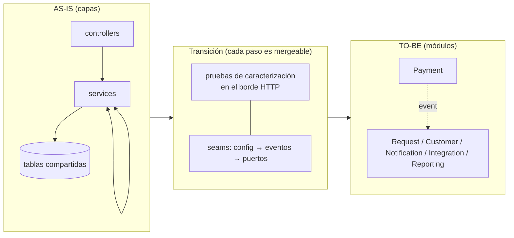
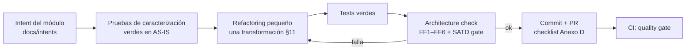
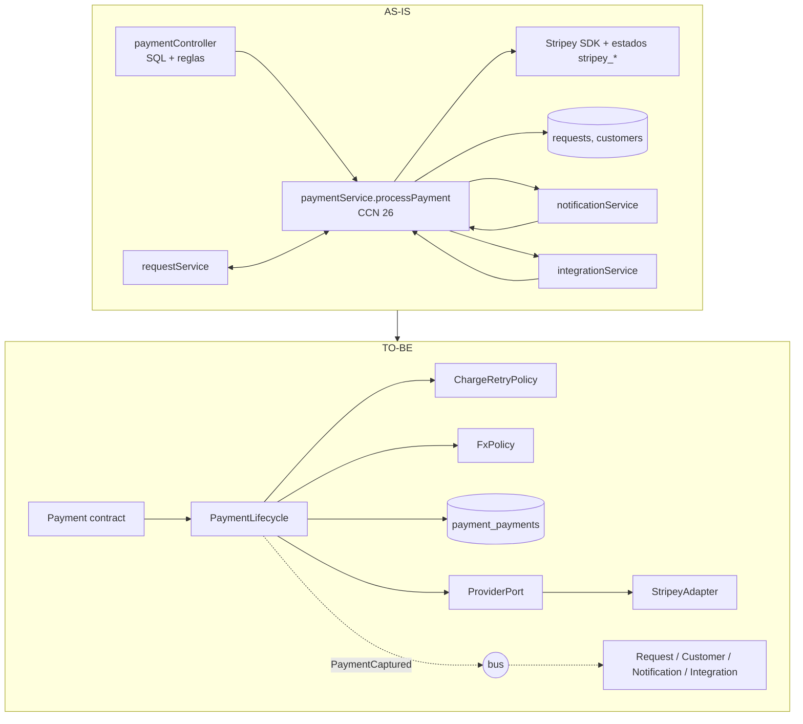
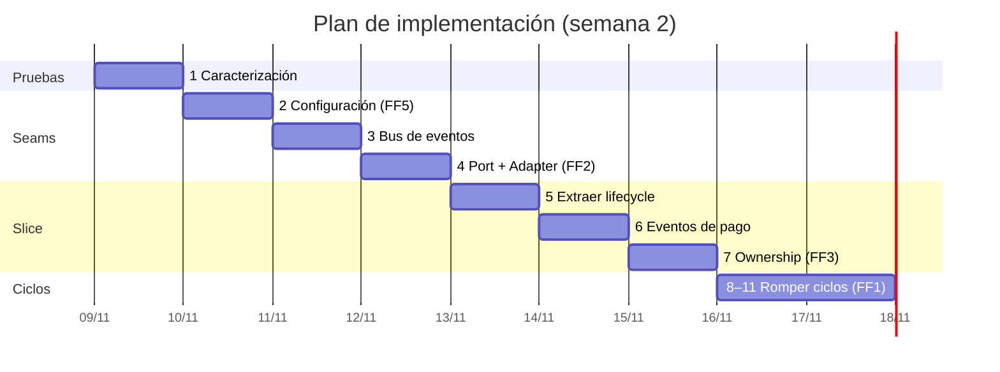
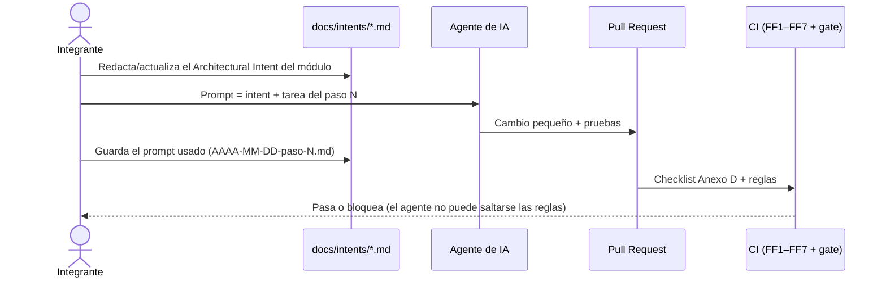

# E3. Plan e implementación de refactoring

> §17.3, §11, §15 pasos 7–8 · Sin reescritura. Ciclo por paso:
> `CharacterizationTests → SmallRefactoring → Tests → ArchitectureCheck → Commit`
> **Estado:** plan de diseño. Las columnas "Commit/PR" y "Resultado" se completan al ejecutar; ninguna cifra de resultado se anticipa aquí.

**Slice elegido:** Payment **y los ciclos que lo rodean**. **Justificación:** (1) S1 (cambio de proveedor) es el escenario con mayor radio (12 archivos); (2) concentra 5 de las 8 deudas SATD y el método más complejo (`processPayment`, CCN 26); (3) 3 de los 6 ciclos pasan por `paymentService`; (4) permite demostrar adapter, ownership y eventos en un solo recorrido; (5) los 3 ciclos restantes (Customer↔Notification, Customer↔Request y el de 3 nodos) se rompen con la misma técnica y son necesarios para el gate "ciclos = 0".

## 1. Estrategia: strangler interno, un seam por vez

- El **borde HTTP es la red de seguridad**: las pruebas de caracterización llaman a la API real (Express en puerto efímero, SQLite en memoria, proveedores simulados). Así pueden mover código por dentro sin cambiar las pruebas.
- Cada paso deja el sistema funcionando y es un commit/PR pequeño. No hay rama larga de "reescritura".
- Orden de **menor a mayor riesgo**, y las fitness functions se activan **cuando el paso que las hace verdaderas termina** (ratchet): nunca se apaga una regla ya encendida.

## 2. Ciclo por paso (qué se exige antes de commitear)

## 3. Pruebas de caracterización (paso 1, cierra TD-008)

**Implementadas en el paso 1** (`flownow/test/characterization/`: `payments`, `refunds-retries`, `requests`, `customers`, `webhooks`, `reports`, `auth`; arnés en `test/support/harness.js`). Black-box sobre la API. Cada fila es una prueba que debe estar **verde contra el AS-IS antes de tocar código** y seguir verde después. Las aserciones usan valores esperados explícitos (no se "aprueba" ciegamente la salida actual) y no dependen de ids ni timestamps.

| Comportamiento (invariante) | Prueba | Antes | Después |
|---|---|---|---|
| Pago aprobado: `paid`, solicitud `paid=1`, `erp_invoice` seteada, 1 intento | `POST /payments` con `tok_ok` | ✅ verde en AS-IS | ✅ |
| Descuento por tier aplicado al monto (silver 10 %, gold 15 %) | solicitud + pago | ✅ verde en AS-IS | ✅ |
| Bono gold −5000 si monto > 1.000.000 (TD-003) | pago gold grande | ✅ verde en AS-IS | ✅ |
| Conversión USD ÷950, EUR ÷1030, redondeo a 2 decimales (TD-002) | pago con `currency` | ✅ verde en AS-IS | ✅ |
| Rechazo: `failed`, solicitud sin pagar, aviso "rechazado" | `tok_declined` | ✅ verde en AS-IS | ✅ |
| 3DS: `pending_action`, aviso "acción adicional" | `tok_3ds` | ✅ verde en AS-IS | ✅ |
| Timeout: 3 intentos, `error`, HTTP 502 | `tok_timeout` | ✅ verde en AS-IS | ✅ |
| Doble pago: 409 `solicitud ya pagada` | repetir pago | ✅ verde en AS-IS | ✅ |
| Moneda no soportada / cliente inactivo / solicitud cancelada: 400 | validaciones | ✅ verde en AS-IS | ✅ |
| Reembolso parcial → `paid`; total → `refunded`; excedido → 400; no pagado → 400 | `POST /payments/:id/refund` | ✅ verde en AS-IS | ✅ |
| Reintento: sólo `failed/error`, máx. 3, el anterior pasa a `superseded` | `POST /payments/:id/retry` | ✅ verde en AS-IS | ✅ |
| Cancelar solicitud pagada reembolsa y decrementa abiertas | `POST /requests/:id/cancel` | ✅ verde en AS-IS | ✅ |
| `done` exige pago; transiciones inválidas → 400 | `POST /requests/:id/status` | ✅ verde en AS-IS | ✅ |
| Umbral gold: `total_spent` acumulado > 2.000.000 promueve a gold | pagos sucesivos | ✅ verde en AS-IS | ✅ |
| Efectos: aviso al cliente, factura ERP, evento a CRM (en `outbox`/bitácora) | tras pago ok | ✅ verde en AS-IS | ✅ |
| Webhook de proveedor `charge.succeeded/failed` actualiza pago y solicitud | `POST /integrations/webhook/stripey` | ✅ verde en AS-IS | ✅ |
| Webhook CRM `contact.updated/deleted` | `POST /integrations/webhook/crm` | ✅ verde en AS-IS | ✅ |
| Reporte de ventas: totales por tier/proveedor/moneda en CLP | `GET /reports/sales` | ✅ verde en AS-IS | ✅ |
| Alta de cliente: validaciones, duplicado 409, sync CRM, bienvenida | ✅ verde en AS-IS | ✅ |

Meta de cobertura (FF7): `paymentService`/futuro `modules/payment` ≥ 80 % líneas (hoy 18,9 %), medida por `baseline.sh`.

### Resultado del paso 1 (medido)

- **46 pruebas verdes** sobre el código AS-IS **sin modificar `src/`** (3 corridas consecutivas estables); antes eran 5.
- Cobertura de líneas (`docs/baseline/paso1/cobertura.txt`): `paymentService` **18,9 % → 100 %**, `integrationService` 39,0 % → 100 %, `requestService` 42,2 % → 100 %, global 56,4 % → 98,2 %. Ahora el reporte incluye los controllers (antes ninguna prueba los cargaba).
- Hallazgos de la caracterización (comportamiento actual que se **preserva** salvo decisión explícita):
  1. El límite de 3 reintentos nunca se alcanza encadenando `retry` (cada reintento marca el anterior `superseded`); sólo con 3 cobros fallidos directos sobre la misma solicitud.
  2. `customers.total_spent` suma el monto en la moneda del pago **sin convertir a CLP** (100 USD cuentan como 100): defecto del AS-IS, visible en `GET /reports/customers`.
  3. Los avisos de pago nombran al proveedor ("procesado por Stripey"). **No se fijó en las pruebas**: el TO-BE lo elimina a propósito (invariante de Notification). Es el único cambio de comportamiento observable previsto, además de la lista de compatibilidad TD-010; ambos requieren aprobación y quedan registrados en el ADR correspondiente.
  4. Los webhooks entrantes no exigen token (se caracteriza; la validación de origen es mejora futura, no parte del slice).

## 4. Secuencia incremental

| # | Transformación (§11) | Qué se hace | Deuda | Riesgo | FF que se enciende |
|---|---|---|---|---|---|
| 1 ✅ | **Characterization tests** | suite black-box de §3 sobre el AS-IS (hecho: 46 pruebas) | TD-008 (cerrada) | bajo | FF7 (umbral de cobertura crítica) |
| 2 ✅ | **HardcodedValue → Configuration** | `platform/config` (env + defaults de desarrollo): claves, URLs, tasas FX, flags, secreto de firma | TD-006, parte de TD-002, H-1..H-4 | bajo | **FF5** |
| 3 ✅ | **Seam: bus de eventos** | `platform/events` con `schemaVersion`, aislamiento de fallos y pruebas | TD-009 (registrar) | bajo | — |
| 4 | **DirectVendorDependency → Port + Adapter** | `ProviderPort` + `StripeyAdapter` (ACL de estados/errores); respaldo PayFast como segundo adapter; se elimina `GatewayFactory`/`IPaymentGateway`/`INotifier` triviales | TD-005 | medio | **FF2**, FF2b |
| 5 | **LargeMethod → ExtractClass** | `processPayment` → `PaymentLifecycle` + `ChargeRetryPolicy` + `FxPolicy` (funciones puras con pruebas unitarias) | TD-002 | medio | umbral de complejidad (CCN ≤ 10 en el módulo) |
| 6 | **SharedDataMutation → OwnershipBoundary (eventos)** | Payment publica `PaymentCaptured/Failed/Refunded`; **Request** marca `paid` y **Customer** actualiza `totalSpent`/tier por suscripción; Payment deja de escribir `requests`/`customers`. *Rompe el ciclo Request↔Payment* | — | **alto** | — |
| 7 | **Ownership de tabla** | `PaymentRepository` única vía a `payment_payments` (renombre `payments` → `payment_payments`, `stripey_*` → `provider_*`); presentador HTTP de compatibilidad para los campos legacy | TD-010 | medio | **FF3** (ratchet: `payment_*`, `customer_*`) |
| 8 | **Efectos laterales por eventos** | Notification e Integration suscritos al pago (aviso; factura ERP; evento CRM); se retiran las llamadas directas. *Rompe Payment↔Notification y Payment↔Integration* | TD-004 | medio | — |
| 9 | **Orquestación en Request** | `Request.payRequest` descuenta, valida y llama `Payments.createPayment`; `paymentController` queda como adaptador HTTP delgado (sin SQL) | — | medio | FF6 (fronteras por `contract/`) |
| 10 | **Romper Customer↔Notification** | bienvenida por `CustomerRegistered`; sync CRM sale de Customer (Integration lo hace con reintento) | TD-001 | medio | — |
| 11 | **Romper Customer↔Request** | `open_requests` deja de calcularse en Customer: el gateway HTTP compone `CustomerDirectory.get` + `Requests.countOpen` (API composition). *Rompe los 2 ciclos restantes* | — | medio | **FF1** sobre todo el grafo |
| 12 | **Reporting por proyecciones (alcance ampliado, si hay tiempo)** | `salesReport` lee `reporting_sales` alimentada por eventos; FX sale (usa `amountBase`) | TD-007 | medio | FF3 se amplía a `reporting_*` |

**Predicción de ciclos por paso** (hipótesis de diseño; cada valor se verifica con FF1/`dependencias.json` al ejecutar el paso):

| Tras el paso | 0 | 6 | 8 | 10 | 11 |
|---|---|---|---|---|---|
| Ciclos | 6 | 5 | 3 | 2 | **0** |
| Ciclo que desaparece | — | Request↔Payment | Payment↔Notification, Payment↔Integration | Customer↔Notification | Customer↔Request y el de 3 nodos |

### 4.1. Antes y después del slice Payment

### 4.2. Resultado del paso 2 (medido)

`HardcodedValue → Configuration`: nuevo `src/platform/config.js` (lectura perezosa de variables de entorno, defaults **no secretos** sólo para desarrollo, claves obligatorias con `NODE_ENV=production`). Se retiró `src/config.js` y se eliminaron del resto del código las URLs de proveedores, claves, secreto de firma, credencial admin, remitente de correo y tasas FX.

| Indicador | Antes del paso 2 | Después | Cómo se midió |
|---|---|---|---|
| FF5 (valores fijos en `src/`) | **22 violaciones** (9 URL, 6 FX, 3 clave, 3 correo, 1 secreto) | **0** | `node ci/rules/no-hardcoded.js` sobre `git archive 3a3eb9f` y sobre el árbol actual |
| SATD sin gestionar | 7 | **0** (los 6 marcadores restantes citan su `TD-xxx`; el de `config.js` se resolvió y se retiró) | `scripts/satd-scan.sh --gate` + `ci/rules/ledger-consistency.js` |
| Pruebas | 46 | **50** verdes (4 nuevas de `config`); la suite de caracterización pasa **sin cambios** | `npm test` |
| Cobertura global | 98,2 % | 98,3 % | `docs/baseline/paso2/` |

Las 5 líneas con URLs y 4 con "posibles secretos" que aún muestra `baseline.sh` están **sólo** en `platform/config.js` (el único lugar permitido). Verificado además: con `NODE_ENV=production` y sin variables, la app **no arranca** (falla con "Falta la variable de entorno …"); con las variables, `admin123` deja de funcionar y sólo entra la contraseña configurada.

Efecto de comportamiento: ninguno con la configuración por defecto (la suite de caracterización lo demuestra). El secreto de firma por defecto cambió (`dev-only-token-secret`), lo que sólo invalida tokens ya emitidos.

### 4.3. Resultado del paso 3 (medido)

`platform/events.js`: bus en proceso con sobre versionado (`id`, `type`, `schemaVersion`, `occurredAt`, `payload` inmutable), `subscribe`/`publish`, contratos mínimos por versión (`registerContract`: campos requeridos y tipos, lector tolerante) y **aislamiento de fallos** (un consumidor que falla no impide a los demás ni rompe al publicador; queda en la bitácora acotada `deadLetters()`).

- **12 pruebas nuevas** (`test/platform/events.test.js`): orden de entrega, sobre, aislamiento (síncrono y asíncrono), espera de consumidores async, desuscripción, reentrancia, contrato (campos mínimos/extra/inválido sin entrega), convivencia de v1 y v2, argumentos inválidos, tope de la bitácora. Total: **62 verdes**; la suite de caracterización sigue sin cambios. Cobertura de `events.js`: 100 % líneas.
- `publish` **espera** a los consumidores: así, cuando los pasos 6 y 8 muevan los efectos del pago a eventos, el flujo HTTP conserva su comportamiento (los efectos ocurren antes de responder).
- **Sin cambio de comportamiento:** el bus todavía no está conectado a ningún flujo (es el *seam*; se usa desde el paso 6). No es una abstracción sin presión de cambio: existe para romper los ciclos de ADR-004 y se prueba por separado antes de depender de él.
- TD-009 queda **implementada como mitigación** (bitácora de fallos) y verificada con las pruebas de aislamiento; el outbox sigue siendo evolución futura aceptada.

## 5. Estimación y reparto (supuesto: 10–14 h del equipo, §16.3)

Las fechas son referenciales para dimensionar la secuencia, no un compromiso del docente. El paso 12 es opcional; los pasos 1–11 bastan para el gate del Anexo E.

## 6. Qué queda fuera del slice (y por qué)

- Reporting por proyecciones completo (paso 12) y la separación física de bases de datos: el valor demostrativo ya está en Payment; se deja **diseñado** (E2, ADR-002).
- Identity como módulo aparte: se limita a mover el secreto a configuración (FF5); la extracción es mecánica.
- Todo lo no intervenido sigue con su SATD y se mide con un **ratchet** (no puede aumentar): ver E4.

## 7. Evidencia de comportamiento preservado

| Evidencia | Cómo se obtiene | Criterio |
|---|---|---|
| Suite de caracterización verde en AS-IS y TO-BE | `npm test` antes del paso 2 y tras el paso 11 (y en cada commit en CI) | mismas aserciones, 0 fallos |
| Respuestas HTTP equivalentes | mismas pruebas black-box (mismos status y cuerpos normalizados) | idénticas, salvo la lista de compatibilidad (TD-010) |
| Cobertura de Payment | `baseline.sh` TO-BE | ≥ 80 % líneas en `modules/payment` |
| Estructura | `baseline.sh` TO-BE vs AS-IS | ver matriz E8 |

## 8. Uso de IA y trazabilidad

Cada prompt se basa en el intent del módulo ([E7](E7-architectural-intent.md), [`intents/`](intents/)). Si el agente viola una frontera, **la regla de CI falla**: ese es el control, no la buena voluntad del prompt (pregunta 10 de §20).
