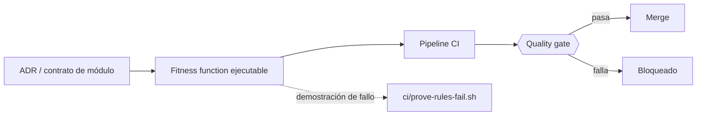
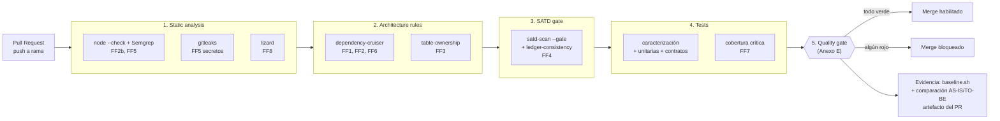
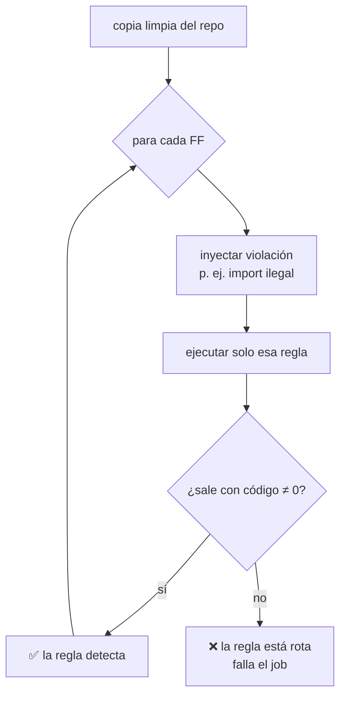
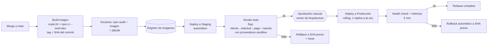
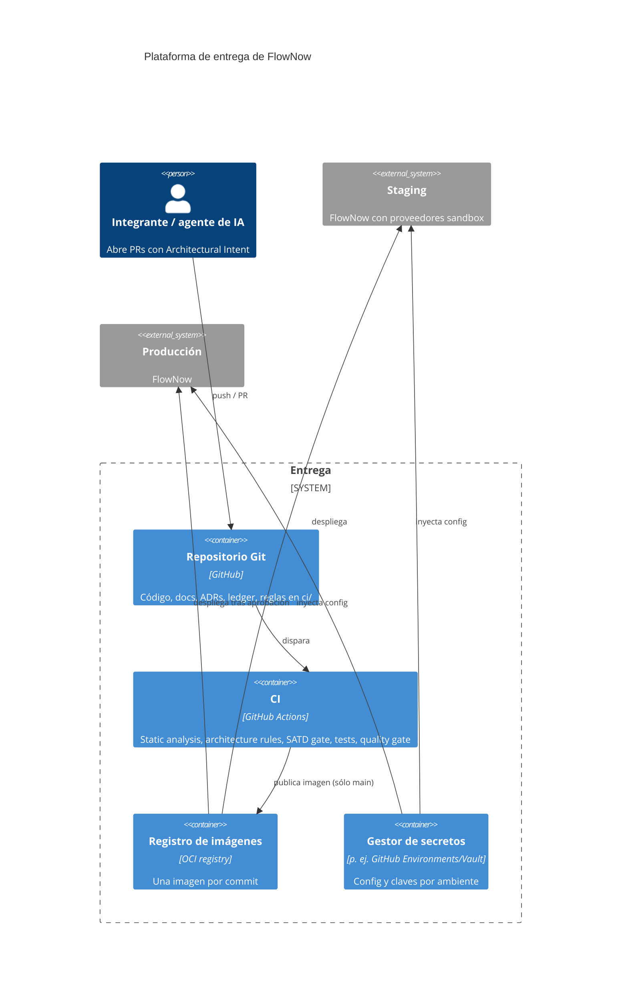
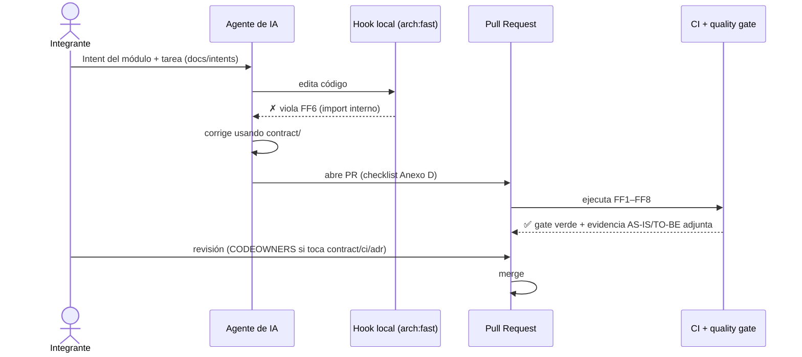

# E4. Fitness Functions, Quality Gate y CI/CD

> §12, §17.4 · Mínimo 3 reglas automatizadas ejecutables en CI. Cada regla debe demostrarse **fallando** ante una violación intencional.
> **Estado:** diseño. FF1 y FF4 ya tienen base ejecutable (`ci/dependency-cruiser.cjs`, `scripts/satd-scan.sh --gate`); el resto se implementa en el orden de [E3](E3-plan-refactoring.md). Los pasos de CI de este documento son el diseño del pipeline; el workflow se activa cuando existan las reglas (no se versiona un pipeline que falle sobre el AS-IS a propósito).

## 1. Principio

Una decisión que sólo vive en un documento no está protegida (§12). Cada ADR tiene al menos una regla que lo hace cumplir **y** que bloquea el merge, también cuando quien escribe el código es un agente de IA.



## 2. Fitness functions

| # | Regla | Decisión que protege (ADR) | Herramienta | Archivo de regla | Alcance / umbral | Demostración de fallo (violación intencional) |
|---|---|---|---|---|---|---|
| **FF1** | No existen ciclos entre módulos | ADR-004, ADR-006 | dependency-cruiser 18.7.0 (`no-circular`) | `ci/dependency-cruiser.cjs` ✅ base | todo `src/`; **0** ciclos (AS-IS: 6). Ratchet desde el paso 1 (no puede superar 6) y bloqueante en 0 desde el paso 11 | `payment` requiere `request`, y `request` requiere `payment` |
| **FF2** | El SDK/tipos del proveedor de pagos no salen de su adapter | ADR-003 | dependency-cruiser (`not-to-sdk-outside-adapter`) | `ci/dependency-cruiser.cjs` | sólo `modules/payment/adapters/**` puede importar `vendor/stripey-sdk` | `notification` importa `stripey-sdk` |
| **FF2b** | Nombres de proveedor no aparecen fuera de adapters | ADR-003 | Semgrep (`pattern-regex`) | `ci/semgrep/provider-names.yml` | `stripey|payfast|hubcrm|mailblast|smsgo|acme` fuera de `adapters/**`, `platform/config` y `payment/http/legacy-presenter` (TD-010); **0** | escribir `'stripey'` en `request` |
| **FF3** | Sólo el owner lee/escribe sus tablas | ADR-001, ADR-002 | script Node `ci/rules/table-ownership.js` (reutiliza `scripts/data-access.js`) + `ci/ownership.json` | `ci/rules/`, `ci/ownership.json` | tablas `<módulo>_*` sólo mencionadas bajo `modules/<módulo>/`; **ratchet** para lo aún no migrado (`ci/ownership-ratchet.json`: puede bajar, no subir) | `notification` ejecuta `SELECT … FROM payment_payments` |
| **FF4** | Sin SATD no gestionada en código nuevo/intervenido | ADR-005 | `scripts/satd-scan.sh --gate` + `ci/rules/ledger-consistency.js` | `scripts/`, `ci/rules/` ✅ **implementada** (paso 2) | **0**; cada `TD-xxx` citado existe en el ledger con owner, fecha y verificación | agregar `// TODO arreglar` sin ticket |
| **FF5** | Sin URLs/secretos/valores de ambiente hard-coded | ADR-005 | script portable `ci/rules/no-hardcoded.js` (regex; equivalente a una regla Semgrep, §12) + gitleaks para el historial (pendiente) | `ci/rules/no-hardcoded.js` ✅ **implementada** (paso 2) | **0** fuera de `platform/config` (defaults de desarrollo) y `test/`; gitleaks sobre el historial del PR | `const KEY = 'sk_live_…'` o `fetch('https://api.x.com')` |
| **FF6** | Dependencias prohibidas bloquean el merge | ADR-004 | dependency-cruiser (`only-via-contract`, `payment-is-leaf`, `no-sql-in-http`) | `ci/dependency-cruiser.cjs` | entre módulos sólo se importa `modules/<m>/contract`; Payment no importa módulos; `http/` no importa `db`; **0** violaciones | `request` importa `payment/domain/PaymentLifecycle` |
| **FF7** | Pruebas críticas y contratos siguen pasando | §11, E3 | `node:test` con cobertura + `ci/rules/coverage-threshold.js` | `ci/rules/` | caracterización + contrato verdes; cobertura de `modules/payment` ≥ 80 % líneas | borrar una prueba de Payment o romper un schema de evento |
| **FF8** | La complejidad no aumenta | §8 | lizard 1.24.3 + ratchet | `ci/lizard-ratchet.json` | CCN máx. del alcance intervenido ≤ 10; en el resto no puede subir (AS-IS máx.: 26) | función nueva con CCN > 10 |

Son **8 reglas automatizadas** (exigidas ≥3). FF1–FF4 cubren las cuatro de §12.2 de forma directa; FF5, FF6, FF7 y FF8 cubren las demás (valores de ambiente, dependencias prohibidas, contratos y pruebas, complejidad).

### 2.1. Reglas de ejemplo

```js
// ci/dependency-cruiser.cjs (extracto de diseño)
forbidden: [
  { name: 'no-circular', severity: 'error', from: {}, to: { circular: true } },                      // FF1
  { name: 'not-to-sdk-outside-adapter', severity: 'error',                                          // FF2
    from: { pathNot: '^src/modules/payment/adapters/' }, to: { path: 'vendor/stripey' } },
  { name: 'only-via-contract', severity: 'error',                                                   // FF6
    from: { path: '^src/modules/([^/]+)/' },
    to: { path: '^src/modules/([^/]+)/', pathNot: ['^src/modules/$1/', '^src/modules/[^/]+/contract/'] } },
  { name: 'payment-is-leaf', severity: 'error',
    from: { path: '^src/modules/payment/' }, to: { path: '^src/modules/(?!payment/)' } },
  { name: 'no-sql-in-http', severity: 'error',
    from: { path: '/http/' }, to: { path: '^src/platform/db' } },
]
```

```yaml
# ci/semgrep/provider-names.yml (extracto de diseño)
rules:
  - id: provider-name-outside-adapter
    languages: [generic]
    severity: ERROR
    message: "El nombre de un proveedor externo sólo puede aparecer en su adapter (ADR-003)."
    pattern-regex: '(?i)\b(stripey|payfast|hubcrm|mailblast|smsgo)\b'
    paths:
      exclude: ['**/adapters/**', 'src/platform/config*', 'src/modules/payment/http/legacy-presenter.js', 'test/**', 'docs/**']
```

### 2.2. Estado de implementación y demostración de fallo

| Regla | Estado | Evidencia |
|---|---|---|
| FF4 | ✅ implementada | `ci/rules/rules.test.js`: falla con marcador sin ticket, TD inexistente, TD cerrado y entradas sin owner/fecha/verificación; pasa con el estado actual (0 sin gestionar, 10 entradas coherentes) |
| FF5 | ✅ implementada | `ci/rules/rules.test.js`: falla ante URL, clave `sk_live`, secreto, tipo de cambio y correo literales; pasa con `platform/config.js` como único permitido. Sobre el código previo al paso 2 detecta **22** violaciones; hoy **0** |
| FF1 | base (`no-circular`) | 6 ciclos hoy; se enciende como ratchet y bloqueante al paso 11 |
| FF2, FF2b, FF3, FF6, FF7, FF8 | diseñadas | pasos 4, 7, 9 de E3 |

Ejecución local de todo lo disponible: `ci/run-rules.sh` (mismo orden que el pipeline). Las demostraciones de fallo corren con `node --test "ci/rules/*.test.js"`.

## 3. Pipeline de CI (§12.1)

`Source Code → Static Analysis → Architecture Rules → SATD Gate → Tests → Quality Gate`



Los jobs de una misma etapa corren en paralelo; una etapa no arranca si la anterior falla (feedback rápido y barato primero). **Cualquier fallo bloquea el merge** (branch protection con todos los checks requeridos).

### 3.1. Diseño del workflow (borrador, no activo)

```yaml
# .github/workflows/quality.yml  (se activa cuando FF1–FF8 existen; ver E3)
name: quality
on: [pull_request]
permissions: { contents: read, pull-requests: write }
jobs:
  static:
    runs-on: ubuntu-latest
    steps:
      - uses: actions/checkout@v4
        with: { fetch-depth: 0 }
      - uses: actions/setup-node@v4
        with: { node-version: 24, cache: npm, cache-dependency-path: flownow/package-lock.json }
      - run: cd flownow && npm ci && node --check src/server.js
      - run: node ci/rules/no-hardcoded.js flownow/src                                                 # FF5
      - run: pip install -r ci/requirements.txt && semgrep scan --config ci/semgrep --error flownow/src   # FF2b (cuando exista)
      - uses: gitleaks/gitleaks-action@v2                                                              # FF5 (historial)
      - run: ci/rules/lizard-ratchet.sh flownow/src                                                    # FF8
  architecture:
    needs: static
    runs-on: ubuntu-latest
    steps:
      - uses: actions/checkout@v4
      - uses: actions/setup-node@v4
        with: { node-version: 24 }
      - run: npx --yes dependency-cruiser@18.7.0 --config ci/dependency-cruiser.cjs flownow/src      # FF1, FF2, FF6
      - run: node ci/rules/table-ownership.js flownow/src                                           # FF3
  satd:
    needs: architecture
    runs-on: ubuntu-latest
    steps:
      - uses: actions/checkout@v4
      - run: scripts/satd-scan.sh --gate flownow/src flownow/test                                   # FF4
      - run: node ci/rules/ledger-consistency.js docs/E5-debt-ledger.md flownow
  tests:
    needs: satd
    runs-on: ubuntu-latest
    steps:
      - uses: actions/checkout@v4
      - uses: actions/setup-node@v4
        with: { node-version: 24, cache: npm, cache-dependency-path: flownow/package-lock.json }
      - run: cd flownow && npm ci && npm test -- --experimental-test-coverage                       # caracterización + contratos
      - run: node ci/rules/coverage-threshold.js                                                    # FF7
  quality-gate:
    needs: tests
    runs-on: ubuntu-latest
    steps:
      - uses: actions/checkout@v4
      - run: scripts/baseline.sh flownow docs/baseline/to-be                                        # evidencia TO-BE
      - run: ci/quality-gate.sh docs/baseline/to-be                                                 # Anexo E
      - uses: actions/upload-artifact@v4
        with: { name: evidencia-to-be, path: docs/baseline/to-be }
```

### 3.2. Quality gate (Anexo E) como script

`ci/quality-gate.sh` lee los artefactos del pipeline y evalúa cada umbral; imprime la tabla y sale con código ≠ 0 si alguna falla. No hay umbrales escritos a mano en el workflow.

| Regla (Anexo E) | Umbral | Cómo se evalúa | Resultado AS-IS (medido) | Resultado TO-BE |
|---|---|---|---|---|
| SATD no gestionada en código intervenido | 0 | `satd-scan.sh --gate` | 8 | *se mide al implementar* |
| Ciclos entre módulos TO-BE | 0 | `dependencias.json` (FF1) | 6 | *se mide* |
| Dependencias prohibidas | 0 | FF2 + FF6 | no existe la regla | *se mide* |
| Hard-coded de secretos/URLs de ambiente | 0 | FF5 (Semgrep + gitleaks) | 9 líneas URL · 7 líneas posibles secretos | *se mide* |
| Fitness functions automatizadas | ≥ 3 | cuenta de reglas activas y verdes en `ci/` | 0 | 8 diseñadas |
| ADRs | ≥ 5 | `docs/adr/ADR-*.md` completos (sin campos vacíos) | 0 completos | 6 redactados |
| Escenarios de cambio comparados | ≥ 4 | `escenarios.csv` AS-IS y TO-BE | 5 medidos | *se mide* |
| Pruebas críticas | pasan antes y después | `npm test` en AS-IS (commit base) y TO-BE | 5 pasan (no cubren pagos) | *se mide* |

## 4. Demostrar que cada regla falla (obligatorio)

`ci/prove-rules-fail.sh` copia el repo a un directorio temporal, inyecta **una** violación por regla y verifica que la regla correspondiente termina con código ≠ 0 y que sin violación termina en 0. Corre en CI cuando cambia `ci/**` y de forma semanal, y su salida se guarda como evidencia en E8.



## 5. CD: del merge al ambiente



Decisiones de CD:

- **Inmutabilidad:** una imagen por commit; lo que se prueba en staging es exactamente lo que va a producción.
- **Configuración por ambiente** vía variables/secretos del gestor (nunca en la imagen ni en el repo): URLs de proveedores, claves, tasas FX, flags (`ENABLE_SMS`, proveedor activo), secreto de firma. FF5 garantiza que el repo no los contiene; **la clave `sk_live_…` del historial debe rotarse** (TD-006).
- **Migraciones de esquema** (renombre de tablas del paso 7 de E3) con patrón *expand/contract*: agregar la tabla nueva y doble escritura, migrar lectura, retirar la antigua en un release posterior. Sólo hacia adelante, con respaldo previo.
- **Rollback:** redeploy del SHA anterior; los eventos versionados `v1` permiten convivir con consumidores antiguos un ciclo.
- **Proveedores:** staging usa sandbox; el smoke test no cobra dinero real.

### 5.1. Vista de contenedores del pipeline (C4)



## 6. Protecciones que hacen cumplir el proceso

| Protección | Qué impide | Cubre |
|---|---|---|
| Branch protection en `main`: checks `static`, `architecture`, `satd`, `tests`, `quality-gate` requeridos; sin push directo | saltarse el gate | ADR-005 |
| `CODEOWNERS` por carpeta: `src/modules/<m>/contract/**`, `ci/**`, `docs/adr/**`, `docs/E5-debt-ledger.md` requieren revisión del rol A (Arquitectura) | cambiar un contrato, una regla o el ledger sin revisión | ADR-001/004 |
| Plantilla de PR con el checklist del Anexo D (`.github/PULL_REQUEST_TEMPLATE.md`) | olvidar el secreto, el owner o el ADR | Anexo D |
| Hook local (`npm run arch:fast` = FF1+FF4+FF2b, <10 s) también como hook del agente de IA (post-edición) | que el agente descubra la violación sólo en CI | pregunta 10 de §20 |
| Intent versionado en `docs/intents/` y referenciado en `CLAUDE.md` | prompts "haz que funcione" sin fronteras | E7 |
| Job semanal `prove-rules-fail` | reglas que dejaron de detectar (falsa seguridad) | §12 |

## 7. Del PR al merge con un agente de IA



## 8. Qué se implementa y cuándo

| Paso de E3 | Entregable de CI que se agrega |
|---|---|
| 1 | `npm test` en el pipeline + FF7 (umbral inicial sobre lo caracterizado) |
| 2 | FF5 (Semgrep + gitleaks) y FF4 con `ledger-consistency` |
| 4 | FF2 y FF2b |
| 7 | FF3 con ratchet |
| 9 | FF6 completo |
| 11 | FF1 sobre todo el grafo (ya bloqueante) y `quality-gate.sh` |
| cierre | `prove-rules-fail.sh`, branch protection y CD a staging |
