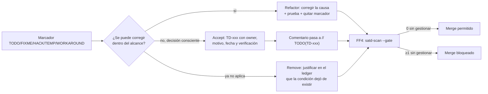

# E5. Gestión de SATD — Debt Ledger

> §7, §17.5 · Meta del alcance intervenido: `UnmanagedSATD = 0`.
> **Borrar el comentario no elimina la deuda.** Deuda aceptada: `SATD → Issue → Owner → Rationale → DueDate → Verification`.
>
> Convención: una SATD queda **gestionada** cuando su comentario referencia un ID del ledger, p. ej. `// TODO(TD-004): ...`. `scripts/satd-scan.sh --gate` falla si encuentra marcadores sin `TD-xxx`.
> **Estado:** propuesta de decisiones sobre el inventario real del AS-IS. Owners por rol (A Arquitectura · B Diagnóstico · C Refactoring · D Calidad/CI, ver `PLAN.md`); asignar personas al conformar el equipo.

## Flujo de gestión

## Inventario inicial

Fuente: `docs/baseline/as-is/satd.csv` (`scripts/satd-scan.sh flownow/src flownow/test`) · Total: **8** · En `src/`: 7 · En `test/`: 1 · Con ticket: **0** (AS-IS: SATD no gestionada = 8).

Clasificación según la literatura citada en §7 (diseño, defecto, documentación, requisitos, pruebas):

| Tipo | Cantidad | IDs |
|---|---|---|
| Diseño | 3 | TD-002, TD-005, TD-006 |
| Defecto | 2 | TD-001, TD-004 |
| Requisitos | 1 | TD-003 |
| Pruebas | 1 | TD-008 |
| Duplicación/diseño | 1 | TD-007 |
| Documentación | 0 | — |

## Ledger (plantilla Anexo B)

| ID | Tipo | Evidencia / ubicación | Decisión | Rationale | Owner | Fecha límite | Verificación | Estado |
|---|---|---|---|---|---|---|---|---|
| TD-001 | Defect | `services/customerService.js:21` `FIXME: reintentar luego, hoy se pierde el contacto` (sync con CRM) | **Refactor** | El alta de cliente ya no llama al CRM: publica `CustomerRegistered` e Integration sincroniza con reintento y bitácora (ADR-003/004). | D (Calidad) + C | 2026-11-15 | prueba `registration-events.test.js`: CRM caído no rompe el alta, reintenta 3 veces, queda en `deadLetters` y `crm/resync` lo repara | **Aceptada (residual) · revisada 2026-11-04.** **Mitigada (paso 10)** · falta cola de reintentos automática (se acepta; mismo mecanismo que TD-004/TD-009) |
| TD-002 | Design | `services/paymentService.js:33` `TEMP: tipo de cambio fijo` (950/1030) | **Refactor** | FX es política de Payment: `FxPolicy` con tasas externalizadas (FF5). | C | 2026-11-15 | caracterización de conversión USD/EUR antes y después; FF5 sin literales | **Aceptada (residual) · revisada 2026-11-04.** **Parcial (pasos 2 y 5):** tasas externalizadas a `config.fx.rates` (FF5 = 0) y centralizadas en `FxPolicy` (con pruebas unitarias); sigue pendiente un servicio de FX real. Marcador cita `TD-002` |
| TD-003 | Requirement | `services/paymentService.js:32` `HACK: bono comercial… por teléfono con ventas` (−5000 si gold y > 1.000.000) | **Accept** (temporal) | Regla de negocio sin respaldo documentado; se **preserva** el comportamiento (§11), se traslada a pricing de Request y se confirma con el negocio. No se puede decidir sola por el equipo. | A (consulta al docente/negocio) | 2026-11-08 | confirmación escrita; si se elimina, prueba de caracterización actualizada y ADR | **Aceptada, a la espera de confirmación del negocio · revisada 2026-11-04.** **paso 9:** la regla ya vive en `modules/request/pricing.js` (política de Request, con su prueba unitaria); el marcador `HACK(TD-003)` se movió allí. Sigue pendiente la confirmación del negocio |
| TD-004 | Defect | `services/paymentService.js:81` `TODO: cola de reintentos para facturas` (ERP caído) | **Accept** | Mover la factura a Integration y registrar la falla en `integration_log` es corrección parcial; la **cola de reintentos** es mejora fuera del slice. | D | 2026-11-15 | prueba: factura fallida queda en bitácora con estado `pending`; revisión del ledger | **Aceptada · revisada 2026-11-04.** **paso 6:** la factura ahora la emite Integration al recibir `Payment.Captured`; el marcador `TODO(TD-004)` se movió a `modules/integration/subscriptions.js`. Un fallo del ERP ya no puede afectar al cobro, pero la cola de reintentos sigue pendiente |
| TD-005 | Design | `services/paymentService.js:45` `WORKAROUND: proveedor de respaldo payfast` | **Refactor** (o Remove si el negocio confirma que no se usa) | Es una segunda variante real de proveedor: justifica `ProviderPort`. Hoy es código inline, sin pruebas ni contrato. | C | 2026-11-15 | contract test del adapter de respaldo con fake; FF2 (sin nombre `payfast` fuera del adapter) | **Aceptada (residual), a la espera de decisión del negocio · revisada 2026-11-04.** **Parcial (paso 4):** PayFast es un adapter del puerto con pruebas de contrato (`test/modules/payment/provider-contract.test.js`) y el marcador `WORKAROUND` se retiró al corregirse. Queda la decisión del negocio sobre reembolsos de cobros de respaldo (`TODO(TD-005)` en `providers/index.js`) |
| TD-006 | Design | `config.js:7` `TODO: mover a un secret manager` (clave `sk_live_…` en el repo) | **Refactor** | Secreto de ambiente en código; debe venir de variable de entorno/secreto. La clave expuesta debe **rotarse** (está en el historial de git). | D | 2026-11-08 | FF5 sin secretos literales; rotación registrada | **Código corregido; cierre operacional pendiente (rotar la clave) · revisada 2026-11-04.** **Código corregido (paso 2):** la clave sale de `STRIPEY_API_KEY` (obligatoria en producción) y el marcador se retiró. **Pendiente operacional:** rotar la clave `sk_live_…` que sigue en el historial de git (owner D); no es verificable desde el repo |
| TD-007 | Design | `services/reportService.js:16` `TEMP: mismo tipo de cambio fijo` | **Refactor** | Duplica la regla de TD-002; Reporting usa `amountBase` del evento de Payment (una fuente de FX). | C | 2026-11-15 | prueba de `salesReport` en USD/EUR; búsqueda de literales 950/1030 = 0 | **Aceptada (residual) · revisada 2026-11-04.** **Parcial (pasos 2 y 5):** literales 950/1030 = 0 (FF5) y Reporting ya usa la `FxPolicy` de Payment (una sola fuente de conversión). Sigue pendiente recibir `amountBase` en el evento de pago (paso 12). Marcador cita `TD-007` |
| TD-008 | Test | `test/helpers.test.js:8` `TODO: agregar pruebas de pagos, reembolsos y webhooks` | **Refactor** | Es el primer paso de E3: pruebas de caracterización antes de mover lógica. | C | 2026-11-08 | cobertura de `paymentService` y `integrationService` ↑; pruebas verdes antes y después | **Cerrada** (paso 1 de E3): marcador retirado porque la condición se corrigió; 46 pruebas verdes sobre el AS-IS; `paymentService` 18,9 % → 100 % líneas, `integrationService` 39,0 % → 100 % (`docs/baseline/paso1/`) |
| TD-009 | Design (decisión consciente, sin marcador) | Eventos en proceso (ADR-004): sin garantía de entrega ante caída entre commit y publicación | **Accept** | Con un solo proceso y ~700 LOC, un outbox/broker sería sobreingeniería (§5). Se registra para que no sea deuda oculta. | A | 2026-11-15 (revisión) | prueba de aislamiento de fallos del bus; bitácora de eventos; escenario documentado en E8 | **Aceptada**; mitigación implementada y probada en el paso 3 (`test/platform/events.test.js`: aislamiento, bitácora acotada). Sigue vigente la ausencia de outbox |
| TD-010 | Design (decisión consciente, sin marcador) | Respuestas HTTP de pagos siguen exponiendo `stripey_charge_id`/`stripey_status` (compatibilidad con clientes actuales) | **Accept** | Cambiar el contrato HTTP rompería consumidores; se confina a **un** presentador de compatibilidad `payment/http/legacy-presenter` (allowlist explícita de FF2b) mientras se versiona la API (§6.2). | A | 2026-11-15 (revisión) | FF2b sólo permite el nombre del proveedor en ese archivo; prueba de compatibilidad de la respuesta | **Implementada (paso 7):** presentador `payment/http/legacy-presenter.js` + suite de caracterización con los nombres legados. La deuda sigue vigente hasta versionar la API |
| TD-011 | Defect (hallazgo de caracterización, sin marcador) | Una confirmación tardía del proveedor (webhook `charge.succeeded` tras un 3DS) marca el pago y la solicitud pero **no suma `total_spent` ni emite factura ERP** (`test/modules/payment/events.test.js`) | **Accept** | Corregirlo es un cambio de comportamiento de negocio (cuentas del cliente y facturación) que el equipo no puede decidir solo; se preserva con el evento `Payment.Confirmed`, que sólo consume Request. | A (consulta al docente/negocio) | 2026-11-15 | decisión escrita; si se corrige, `Payment.Confirmed` pasa a consumirse también por Customer e Integration y se actualiza la prueba | **Aceptada por el equipo (preserva el comportamiento); decisión del negocio pendiente · revisada 2026-11-04.** |
| TD-012 | Defect (hallazgo de caracterización, sin marcador) | Si el proveedor de pagos no responde (502), el cliente recibe "Pago pendiente: tu pago requiere una acción adicional" (`modules/notification/payment-messages.js`) | **Accept** | El texto no distingue una caída del proveedor de un 3DS; corregirlo es un cambio de comunicación al cliente que se decide con el negocio. Se preserva y queda cubierto por prueba. | A (consulta al docente/negocio) | 2026-11-15 | texto acordado; prueba de `paymentMessage` y del caso de proveedor caído actualizada | **Aceptada por el equipo (preserva el comportamiento); decisión del negocio pendiente · revisada 2026-11-04.** |

Tipos: Design · Defect · Documentation · Requirement · Test.

### Hallazgos de valores fijos que **no** son comentarios SATD

No cuentan en la métrica de SATD, pero rompen FF5 y deben resolverse en el alcance (se vigilan con Semgrep, no con `satd-scan`):

| ID | Ubicación | Qué es | Acción |
|---|---|---|---|
| H-1 | `utils/helpers.js` (`SECRET`) y `controllers/authController.js` (admin sembrado `admin123`) | secreto de firma y credencial por defecto en código | configuración + credencial inicial por entorno (Identity) |
| H-2 | `notificationService.js`, `notificationController.js` (`smsgo_live_8812`) | clave de SMS literal repetida | configuración del adapter SMS |
| H-3 | 9 líneas con URLs de proveedores (`hubcrm`, `erp.acme-internal.net`, `mailblast`, `smsgo`, `payfast`) | URLs de ambiente | configuración por adapter |
| H-4 | `requestService.js` (límite 10, umbrales 500000/20000), `paymentService.js` (umbral gold 2.000.000) | políticas como números mágicos | constantes nombradas dentro de su módulo (política, no secreto) |

## Reglas de operación

1. Todo marcador nuevo debe nacer como `// TODO(TD-xxx)` con su fila en el ledger (FF4).
2. Una deuda `Accept` sin owner, fecha o verificación **no** cuenta como gestionada.
3. Al cerrar una deuda: `Estado = Cerrada`, enlace al commit/PR y a la prueba que la verifica.

## Estado final

Medido sobre el TO-BE (commit `0f8e8f3`; `docs/baseline/to-be/satd.csv`, `scripts/satd-scan.sh --gate`):

| | AS-IS | TO-BE (medido) |
|---|---|---|
| Marcadores SATD en el código | 8 (todos sin ticket) | **5**, todos con `TD-xxx` (TD-002, 003, 004, 005, 007) |
| **SATD no gestionada** | **8** | **0** (FF4 = 0; ledger consistente) |
| Corregidas y marcador retirado | — | TD-008 (**cerrada**); TD-001 (corregida en lo principal, residual aceptado); TD-006 (código corregido) |
| Parcialmente corregidas, residual aceptado | — | TD-002, TD-005, TD-007 (conservan su marcador citando el TD) |
| Aceptadas y registradas | — | TD-003, TD-004 (con marcador); TD-009, TD-010 (decisiones sin marcador); TD-011, TD-012 (hallazgos sin marcador) |
| Pendientes que NO se pueden cerrar desde el repositorio | — | **TD-006** (rotar la clave `sk_live_…`, que está en el historial y en el remoto); **TD-003, TD-005, TD-011, TD-012** (decisión del negocio/docente) |

Lectura honesta: `UnmanagedSATD = 0` se cumple, pero sólo **TD-008 está cerrada de verdad**. Las demás están *gestionadas* (con owner, fecha y verificación), no resueltas; tres de ellas dependen de decisiones de negocio y una de una acción operacional (rotación de la clave). Los owners son **roles** (A–D); falta asignar personas.
