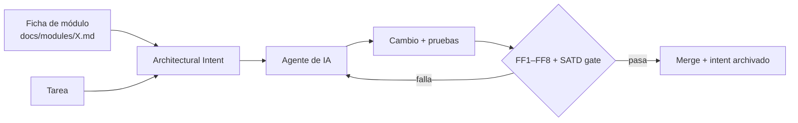

# E7. Architectural Intent Prompt (reusable)

> §13, §17.7 · Contrato que se entrega a un agente de IA **antes** de pedirle código, para que implemente una nueva capacidad sin romper las fronteras.
> *Vibe Architecting:* el prompt deja de pedir "haz que funcione" y declara **responsabilidad, secreto, frontera, datos, restricciones y evidencia**.

## Cómo usarlo

1. Copiar el bloque, completar los campos del módulo objetivo (desde `modules/<módulo>.md`).
2. Agregar la tarea concreta en `Task`.
3. Guardar el prompt usado en `intents/AAAA-MM-DD-<tarea>.md` (trazabilidad).
4. Validar el resultado con el checklist de PR (Anexo D) y las fitness functions (E4). **El control real es CI, no el prompt.**



## Plantilla

```
ARCHITECTURAL INTENT

Module:
<módulo>

Responsibility:
<qué problema resuelve>

Secret:
<qué decisión de diseño oculta>

Owned data:
<entidades/tablas que gobierna, con prefijo del módulo>

Allowed dependencies:
<contratos de los que puede depender: modules/<m>/contract y platform>

Forbidden dependencies:
<tablas/implementaciones ajenas; imports a internos de otros módulos; SDKs fuera del adapter>

Public contract:
<operaciones / eventos expuestos — no modificar sin ADR y sin versionar>

Quality constraints:
- no circular dependency (FF1)
- provider SDK/names only inside the adapter (FF2, FF2b)
- only the owner reads/writes its tables (FF3)
- no unmanaged SATD: any TODO/FIXME/HACK/TEMP/WORKAROUND must reference TD-xxx (FF4)
- configuration externalized: no hard-coded URLs, secrets or rates (FF5)
- cross-module imports only through modules/<m>/contract (FF6)
- no new abstraction without a concrete change pressure (name it)
- behavior preserved by tests: write characterization tests first (FF7)
- complexity must not increase; new functions CCN <= 10 (FF8)
- small incremental changes, no rewrite

Evidence required:
unit tests + contract tests + passing architecture rules + ADR update if a boundary changes + Debt Ledger entry for any accepted debt

Task:
<capacidad a implementar>

Before coding, answer: (1) which module owns this change? (2) which contract do you touch? (3) which scenario of change does it improve? Stop and ask if the task requires crossing a forbidden dependency.
```

## Ejemplo completo: agregar un canal de WhatsApp (escenario S2)

Intent listo para entregar a un agente: [`intents/ejemplo-notification-whatsapp.md`](intents/ejemplo-notification-whatsapp.md). Resumen de lo que el agente **debe** hacer y de lo que las reglas **le impiden**:

| El agente debe | Si no lo hace, falla |
|---|---|
| Crear `modules/notification/adapters/whatsapp/` implementando `ChannelPort` | FF2b: nombre de proveedor fuera de un adapter |
| Leer URL y clave de `platform/config` | FF5: URL/clave literal |
| Obtener el teléfono con `CustomerDirectory.getContactInfo` | FF3/FF6: acceso a `customer_*` o a internos de Customer |
| Registrar el envío en `notification_log` (único owner) | FF3 |
| Agregar prueba con un fake de `ChannelPort` | FF7: cobertura/pruebas |
| No tocar Payment, Request ni Customer | FF6 / S2 = 1 módulo |

## Ejemplo de validación

**Pendiente de ejecución.** Cuando el TO-BE exista, se entrega este intent a otro agente (sin contexto previo) y se registra: archivos tocados, módulos afectados (meta: 1), resultado de FF1–FF8 y el diff. Ese registro va a E8 como evidencia del escenario S2. Mientras tanto, la validación de diseño es el cuadro anterior: cada restricción tiene una regla que la hace cumplir.
