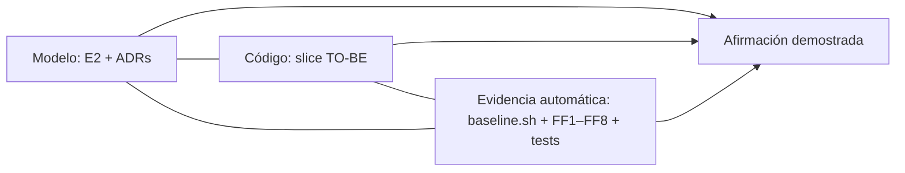

# E8. Informe de evidencia AS-IS / TO-BE

> §17.8, §19 · Triangulación: `ArchitectureModel + SourceCode + AutomatedEvidence`.
> Cifras generadas por `scripts/baseline.sh` en `docs/baseline/as-is/` y `docs/baseline/to-be/`.
> **Estado:** la columna AS-IS está **medida**. La columna TO-BE contiene **metas de diseño** (marcadas) y se reemplaza por la medición real al ejecutar `scripts/baseline.sh flownow docs/baseline/to-be`. Ninguna meta se presenta como resultado.

## Matriz (§17.8)

| Indicador | AS-IS (medido) | TO-BE (meta de diseño) | Fuente |
|---|---|---|---|
| SATD no gestionada | **8** | 0 | `satd-resumen.txt` / FF4 |
| Ciclos entre módulos | **6** | 0 | `dependencias.json` / FF1 |
| Dependencias prohibidas | no medidas (la regla no existe) | 0 | FF2 + FF6 |
| Hard-coded críticos | 9 líneas con URLs · 7 con posibles secretos | 0 o justificados (defaults de desarrollo en `platform/config`) | `urls.txt`, `posibles-secretos.txt` / FF5 |
| Datos sin owner | **5 de 6 tablas** con escritura múltiple | 0 | `acceso-datos.csv` / FF3 |
| Complejidad extrema | 3 funciones con CCN > 10; máx. **26** | ↓ (≤ 10 en el alcance intervenido) | `complejidad.csv` / FF8 |
| Duplicación relevante | **7,87 %** (13 clones, umbral 25 tokens/3 líneas) | ↓ | `jscpd/` |
| Cobertura crítica (`paymentService`) | **18,9 %** líneas · 0 % funciones | ↑ (≥ 80 % en `modules/payment`) | `cobertura.txt` / FF7 |
| Cambio de proveedor afecta | **12 archivos / 5 áreas** | acotado: 1 módulo (adapter + config) | `escenarios.csv` (S1) |
| Archivos que nombran a Stripey | **11** (51 ocurrencias) | 1 módulo (`adapters/` + presentador de compatibilidad TD-010) | `proveedores.csv` / FF2b |
| Controllers con SQL directo | **7** | 0 | `acceso-datos.csv` / FF6 |
| ADRs | 0 completos (plantillas vacías) | ≥ 5 (**6 redactados**) | `docs/adr/` |
| Fitness functions | 0 | ≥ 3 (**8 diseñadas**, 2 con base ejecutable) | `ci/` |
| Pruebas | 5 (sin pagos) | caracterización + contratos | `cobertura.txt` |
| Fan-in máx. (`db.js`, `helpers.js`) | **14** | `utils/helpers` eliminado; `db` sólo por módulo | `dependencias.json` |

## Escenarios de cambio comparados (≥ 4, §15 paso 2)

| # | Escenario | Impacto AS-IS (medido) | Impacto TO-BE (meta) | Regla que lo protege |
|---|---|---|---|---|
| S1 | Cambiar proveedor de pagos | 12 archivos · 5 áreas | 1 módulo: `payment/adapters` + configuración | FF2, FF2b, FF5 |
| S2 | Nuevo canal de notificación | 7 archivos · 3 áreas | 1 módulo: `notification/adapters` + configuración | FF2b, FF3, FF6 |
| S3 | Cambiar el modelo de Customer | 13 archivos · 7 áreas | 1 módulo (Customer) + DTO `v1`/`v2` | FF3, FF6 |
| S4 | Nueva integración externa | 9 archivos · 5 áreas | 1 módulo (Integration: nuevo adapter) | FF2b, FF5, FF6 |
| S5 | Separar reporting | 7 archivos · 4 áreas | 1 módulo (Reporting) con proyecciones propias | FF3 |

Medición: `scripts/change-impact.js` sobre `docs/escenarios/escenarios.json` (misma definición para AS-IS y TO-BE). Es una heurística; la **demostración fuerte** es ejecutar el cambio real (por ejemplo, sustituir Stripey por un proveedor ficticio) y contar el diff: ese experimento se registra aquí cuando exista el TO-BE.

## Trazabilidad de afirmaciones (§19)

| Afirmación | Problema observado | Decisión (ADR) | Artefacto cambiado | Prueba / regla | Escenario mejorado |
|---|---|---|---|---|---|
| "Cambiar de proveedor de pagos ya no se propaga" | proveedor en 12 archivos / 5 áreas; `stripey_*` en esquema y textos | ADR-003, ADR-001 | `modules/payment/adapters/*`, `platform/config` | FF2 + FF2b + FF5; diff del experimento de cambio de proveedor | S1 |
| "No hay ciclos entre módulos" | 6 ciclos entre servicios | ADR-004 | eventos en `platform`; contratos `contract/` | FF1 (`dependencias.json` = 0) | S1–S4 |
| "Cada dato tiene un único owner" | 5 de 6 tablas con escritores múltiples | ADR-002 | tablas con prefijo, repositorios por módulo | FF3 + `acceso-datos.csv` | S3, S5 |
| "El comportamiento se preservó" | cobertura de pagos 18,9 % | E3 (caracterización primero) | `test/characterization/*` | misma suite verde en AS-IS y TO-BE (FF7) | todos |
| "La deuda está gestionada, no escondida" | 8 SATD sin ticket | ADR-005 | `E5-debt-ledger.md`, comentarios `TD-xxx` | FF4 = 0 sin gestionar; ledger consistente | — |
| "Un agente de IA no reintroduce el problema" | cambios locales por prompt sin frontera | ADR-005, E7 | intents + CI + CODEOWNERS | FF1–FF8 bloquean el merge; `prove-rules-fail` | S2 |

## Qué falta para cerrar este informe

1. Implementar los pasos de E3 y correr `scripts/baseline.sh flownow docs/baseline/to-be`.
2. Reemplazar las metas por las mediciones (`resumen.md` TO-BE) y generar la comparación.
3. Ejecutar el experimento de cambio de proveedor y el de canal WhatsApp (intent de E7) y adjuntar los diffs.
4. Adjuntar la salida de `prove-rules-fail.sh`.

## Conclusión

*Se redacta al tener la medición TO-BE.* La pregunta central (§16.1) se responderá con: (a) el conteo de archivos/módulos de S1–S5 antes y después, (b) las 8 reglas verdes en CI y demostradas fallando, (c) la suite de caracterización idéntica verde, y (d) `UnmanagedSATD = 0` en el alcance intervenido.
