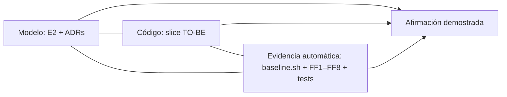

# E8. Informe de evidencia AS-IS / TO-BE

> §17.8, §19 · Triangulación: `ArchitectureModel + SourceCode + AutomatedEvidence`.
> Cifras generadas por `scripts/baseline.sh` en `docs/baseline/as-is/` y `docs/baseline/to-be/`.
> **Estado:** AS-IS y TO-BE están **medidos** (commit `0f8e8f3`; `docs/baseline/as-is/` y `docs/baseline/to-be/`, generados por `scripts/baseline.sh`, sin edición manual). Donde el TO-BE no cumple la meta de diseño o la métrica empeora, se dice explícitamente.

## Matriz (§17.8)

| Indicador | AS-IS (medido) | TO-BE (medido) | Meta | Lectura | Fuente |
|---|---|---|---|---|---|
| SATD no gestionada | **8** | **0** (5 marcadores, todos con `TD-xxx`) | 0 | ✅ cumple | `satd-resumen.txt` / FF4 |
| Ciclos entre módulos | **6** | **0** | 0 | ✅ cumple (FF1 bloqueante) | `dependencias.json` / FF1 |
| Dependencias prohibidas | no medidas | **0** (FF2 + FF6 + FF2b) | 0 | ✅ cumple; FF6 sólo cubre `modules/` (ver límites) | `ci/rules/arch.js` |
| Hard-coded críticos | 9 líneas con URLs · 7 con posibles secretos | 5 · 5, **todas defaults de desarrollo en `platform/config.js`**; FF5 = **0** violaciones | 0 o justificados | ✅ cumple. La clave `sk_live_…` sigue en el **historial** de git (TD-006) | `urls.txt`, `posibles-secretos.txt` / FF5 |
| Tablas con escritura desde >1 archivo | **5 de 6** | **4 de 6** (`payments` → `payment_payments`, un solo archivo escritor) | 0 | ⚠ parcial: sólo Payment tiene owner estricto; el resto está en ratchet | `acceso-datos.csv` / FF3 |
| Controllers con SQL directo | **7** | **6** | 0 | ⚠ parcial: `paymentController` quedó sin SQL; los demás están fuera del slice | `acceso-datos.csv` |
| Complejidad extrema | 3 funciones con CCN > 10; máx. **26**; 1 función con NLOC > 50 | **2** con CCN > 10; máx. **12**; 0 con NLOC > 50 | ≤ 10 en el alcance intervenido | ✅ cumple en `modules/` y `platform/`; ⚠ 2 funciones legadas con CCN 12 (ratchet) | `complejidad.csv` / FF8 |
| Duplicación | **7,87 %** (56/712 líneas) | **5,04 %** (62/1231 líneas) | ↓ | ✅ baja el porcentaje; ⚠ las líneas duplicadas absolutas suben (56→62) | `jscpd/` |
| Cobertura crítica | `paymentService` **18,9 %** líneas, 0 % funciones; global 56,4 % | `modules/payment` **100 %**; `modules/` 99,6 %; global 99,35 % | ≥ 80 % en `modules/payment` | ✅ cumple (cobertura de líneas: no mide la calidad de las aserciones) | `cobertura.txt` / FF7 |
| Pruebas | 5 (sin pagos) | **125** (63 de caracterización sin modificar tras su creación¹) | caracterización + contratos | ✅ | `cobertura.txt` |
| Archivos que nombran a Stripey | **11** (51 ocurrencias) | **11** (37 ocurrencias): 7 dentro de `modules/payment` y `platform/config.js` (permitidos) + **4 legados** (`integrationController`, `paymentController`, `server.js`, `integrationService`) | confinado al adapter | ⚠ el conteo bruto **no cambió**; lo que cambió es que 7 de 11 están donde la regla los permite y los otros 4 están en ratchet (FF2b: 10 → 5 archivos legados en total) | `proveedores.csv` / FF2b |
| ADRs | 0 completos | **6** redactados (estado "Propuesto") | ≥ 5 | ✅ cantidad; ⚠ falta aceptarlos | `docs/adr/` |
| Fitness functions | 0 | **8** activas, cada una demostrada fallando (15 casos) | ≥ 3 | ✅ cumple | `ci/`, `prove-rules-fail.txt` |
| Archivos fuente / LOC / aristas de dependencia | 22 / 714 / 67 | 39 / 1231 / 115 | — | ⚠ **costo**: más archivos, más código y más aristas (`C_coordination`, §5). La mejora no viene de tener menos código, sino de que las aristas apunten a contratos | `resumen.md` |
| Fan-in máx. (`db.js`, `helpers.js`) | 14 / 14 | **16 / 15** | `helpers` eliminado | ❌ **no cumplido**: ambos subieron; los módulos nuevos siguen importando `db` y `helpers` | `dependencias.json` |

¹ La única modificación a la suite de caracterización fue PayFast `attempts` 0 → 1, aprobada (corrige un conteo inconsistente del AS-IS); ver E3.

Quality gate del Anexo E sobre el TO-BE: **APROBADO** (`docs/baseline/to-be/quality-gate.md`).

## Escenarios de cambio comparados (≥ 4, §15 paso 2)

| # | Escenario | Heurística AS-IS (archivos · áreas) | Heurística TO-BE | Demostración real | Regla que lo protege |
|---|---|---|---|---|---|
| S1 | Cambiar proveedor de pagos | 12 · 5 | 11 · 4 | ✅ **experimento ejecutado: 4 archivos, 1 módulo** (ver abajo) | FF2, FF2b, FF5 |
| S2 | Nuevo canal de notificación | 7 · 3 | 5 · 3 | ❌ no ejecutado: Notification no se refactorizó como slice | FF2b, FF3, FF6 |
| S3 | Cambiar el modelo de Customer | 13 · 7 | 14 · 6 | ❌ no ejecutado; Customer sólo se desacopló parcialmente (pasos 10–11) | FF3, FF6 |
| S4 | Nueva integración externa | 9 · 5 | 10 · 5 | ❌ no ejecutado; Integration ahora reacciona a eventos pero conserva SQL y servicio legado | FF2b, FF5, FF6 |
| S5 | Separar reporting | 7 · 4 | 12 · 4 | ❌ no ejecutado; Reporting no se intervino (paso 12 opcional) | FF3 |

**Cómo leer la heurística.** `scripts/change-impact.js` cuenta los archivos cuyo texto coincide con un patrón por escenario (`docs/escenarios/escenarios.json`). Mide "archivos que *mencionan* el concepto", no "archivos que *hay que cambiar*": el TO-BE tiene más archivos, más pequeños, y los nuevos que contienen un término del patrón (adapters, contratos, suscripciones) suman aunque sean el lugar correcto del cambio. Por eso **sólo S1 y S2 mejoran, S3 y S4 empeoran levemente y S5 empeora (7 → 12, porque el contrato de Payment ahora menciona "report" y "summary")**. Estos números **no** demuestran mejora por sí solos y no se presentan como tal; la evidencia fuerte es el experimento de abajo, que sólo existe para S1.

### Experimento S1: agregar un proveedor de pagos ficticio (NovaPay)

Se creó una rama descartable, se agregó un proveedor nuevo con el mismo puerto y se midió el diff (`docs/experimentos/S1-novapay.diff` y `.stat.txt`):

| Archivo | Cambio |
|---|---|
| `modules/payment/adapters/novapay/index.js` | **nuevo** (15 líneas; mismo puerto que Stripey/PayFast) |
| `modules/payment/providers/index.js` | registro del adapter + selección por `PAYMENT_PROVIDER` (2 líneas) |
| `platform/config.js` | URL y flag del proveedor (2 líneas) |
| `test/modules/payment/provider-contract.test.js` | el adapter hereda la batería de contrato (1 línea) |

**Total: 4 archivos, 20 inserciones, 3 eliminaciones; 0 archivos legados (`services/`, `controllers/`, `server.js`) ni de otros módulos.** Las 127 pruebas pasan con el proveedor por defecto y las 8 reglas siguen verdes (FF2b: 0 nuevos; FF5: 0).

**Límite del experimento (hallazgo).** Con `PAYMENT_PROVIDER=novapay` **fallan 24 de 127 pruebas**. No es acoplamiento de producción: esas pruebas usan el vocabulario de Stripey (`tok_declined`, `tok_3ds`, `tok_timeout`) y los campos legados `stripey_*` que se preservan por compatibilidad (TD-010), y el adapter ficticio siempre aprueba. Significa que la suite de caracterización valida el comportamiento *de Stripey*, no un cambio completo de proveedor; no se ejecutó un contrato de pruebas por proveedor con tokens propios. Además, el experimento no incluye webhooks entrantes de NovaPay ni su reembolso real.

## Trazabilidad de afirmaciones (§19)

| Afirmación | Problema observado | Decisión (ADR) | Artefacto cambiado | Prueba / regla | Estado de la evidencia |
|---|---|---|---|---|---|
| "Agregar/cambiar el proveedor de pagos no se propaga" | proveedor en 12 archivos / 5 áreas; `stripey_*` en esquema y textos | ADR-003, ADR-001 | `modules/payment/adapters/*`, `platform/config` | experimento S1 (4 archivos, 1 módulo); FF2 + FF2b + FF5 | ✅ demostrado para *agregar* un proveedor; ⚠ 4 archivos legados aún nombran a Stripey (ratchet) |
| "No hay ciclos entre módulos" | 6 ciclos entre servicios | ADR-004 | eventos en `platform`; contratos `contract/` | FF1 = 0 (`dependencias.json`) | ✅ demostrado |
| "Cada dato tiene un único owner" | 5 de 6 tablas con escritores múltiples | ADR-002 | `payment_payments` + repositorio | FF3 estricta sólo para Payment | ⚠ parcial: 1 de 6 tablas estricta; 4 en ratchet |
| "El comportamiento se preservó" | cobertura de pagos 18,9 % | E3 (caracterización primero) | `test/characterization/*` | misma suite verde antes/después de cada paso (63 pruebas) | ✅ demostrado a nivel de API HTTP; ver cambios aprobados en E3 |
| "La deuda está gestionada, no escondida" | 8 SATD sin ticket | ADR-005 | `E5-debt-ledger.md`, comentarios `TD-xxx` | FF4 = 0; ledger consistente | ✅ (TD-001/2/5/6/7 y 3 aún no cerradas, sólo gestionadas) |
| "Un agente de IA no reintroduce el problema" | cambios locales por prompt sin frontera | ADR-005, E7 | intents + CI + CODEOWNERS | FF1–FF8 + `prove-rules-fail.sh` (15 casos) | ⚠ el diseño está, pero el workflow aún no corrió en GitHub y la branch protection no está configurada |

## Qué queda fuera o sin demostrar

1. **Slice, no sistema.** El slice intervenido es Payment (con Customer/Integration/Notification/Request tocados sólo en sus fronteras con Payment). Notification, Reporting e Identity siguen siendo código legado.
2. **S2–S5 sin experimento real.** No se ejecutó el canal WhatsApp (intent de E7) ni los cambios de S3–S5.
3. **Ownership parcial** (ver matriz) y **fan-in de `db`/`helpers` sin mejorar**.
4. **TD-006:** la clave `sk_live_…` sigue en el historial de git y de GitHub: hay que rotarla; FF5 no revisa historial (gitleaks pendiente).
5. **ADRs en "Propuesto"** y reglas de negocio con duda abierta (TD-003, TD-011, TD-012).
6. **El workflow de CI y la branch protection no se han ejercitado en GitHub.**

## Conclusión (§16.1)

*¿Qué evidencia demuestra que el sistema ahora puede cambiar sin propagar innecesariamente el impacto de ese cambio?*

Para el cambio de **proveedor de pagos**, la evidencia es triangulada: (a) *modelo*: Payment es una hoja con contrato público, su secreto es el proveedor y los eventos versionados reemplazan las llamadas directas (ADR-001, 003, 004); (b) *código*: agregar un proveedor nuevo tocó **4 archivos de un solo módulo** y ninguno del código legado, frente a 12 archivos en 5 áreas en el AS-IS; (c) *evidencia automática*: 0 ciclos (de 6), 0 SATD sin gestionar (de 8), cobertura de Payment 100 % (de 18,9 %), CCN máx. 12 (de 26), 8 fitness functions que bloquean la regresión y fueron demostradas fallando, y la suite de caracterización idéntica verde tras cada paso.

La afirmación **no** puede generalizarse a todo el sistema: sólo S1 tiene un experimento real, Notification/Reporting/Identity no se tocaron, el ownership de datos es estricto para una de seis tablas, y el costo de la separación es visible (39 archivos y 1231 LOC frente a 22 y 714, 115 aristas frente a 67, y mayor fan-in de `db`/`helpers`). El argumento defendible es que el *radio de cambio de la decisión más volátil* quedó confinado y protegido por reglas ejecutables, y que el resto del camino (S2–S5) está planificado y medible con las mismas herramientas.
